# دليل المدير التنفيذي والمسؤول التقني

لمن يحمل دور «المدير التنفيذي» أو «المسؤول التقني». الدوران «مديرا النظام»: لهما الإضافة والتعديل والحذف في لوحة الإدارة كلها، والإعدادات التقنية، ومنح الأدوار كلها عدا عضوية الجمعية العمومية.

اللقطات في هذا الدليل من نسخة محلية من البوابة بحسابات تجريبية، والأرقام فيها ليست أرقام الجمعية.

## المحتويات

1. [الدخول والتحقق الثنائي](#1-الدخول-والتحقق-الثنائي)
2. [رئيسية لوحة الإدارة](#2-رئيسية-لوحة-الإدارة)
3. [محتوى الرئيسية والتذييل والشعار](#3-محتوى-الرئيسية-والتذييل-والشعار)
4. [الإعلانات](#4-الإعلانات)
5. [مكتبة إعجاز](#5-مكتبة-إعجاز)
6. [الأخبار](#6-الأخبار)
7. [بطاقات لوحة المستفيد](#7-بطاقات-لوحة-المستفيد)
8. [المستخدمون والأدوار وإعادة كلمة المرور](#8-المستخدمون-والأدوار-وإعادة-كلمة-المرور)
9. [إعدادات الموقع: التوثيق والأقسام المؤجلة](#9-إعدادات-الموقع-التوثيق-والأقسام-المؤجلة)
10. [البيانات الرسمية للجمعية](#10-البيانات-الرسمية-للجمعية)
11. [البرامج والدورات](#11-البرامج-والدورات)
12. [المسابقات](#12-المسابقات)
13. [الملفات: الأرشيف وملفات الوظائف](#13-الملفات-الأرشيف-وملفات-الوظائف)
14. [الإحصائيات وقياس الرضا](#14-الإحصائيات-وقياس-الرضا)
15. [السجلات والخطة السنوية وحسابات المنصات](#15-السجلات-والخطة-السنوية-وحسابات-المنصات)
16. [ما لا يُفعل وأين تطلب المساعدة](#16-ما-لا-يُفعل-وأين-تطلب-المساعدة)

---

## 1. الدخول والتحقق الثنائي

التحقق الثنائي **إلزامي** لدخول لوحة الإدارة. جهّز قبل أول دخول تطبيق مصادقة على جوالك، مثل Google Authenticator أو Microsoft Authenticator.

### أول دخول: تفعيل التحقق الثنائي

1. افتح الموقع واضغط «تسجيل الدخول» أعلى الصفحة.
2. اكتب في «اسم المستخدم أو البريد أو الجوال» بريدك، ثم «كلمة المرور»، واضغط «دخول».
3. تنتقل إلى صفحة «الأمان». إن طُلبت كلمة المرور («تأكيد كلمة المرور») فاكتبها واضغط «تأكيد».
4. اضغط «تفعيل التحقق الثنائي»، وامسح الرمز المربع بتطبيق المصادقة.
5. اكتب الرمز الظاهر في التطبيق، واضغط «إكمال التفعيل».
6. تظهر «رموز الاسترداد». احفظها في مكان آمن خارج الجوال: هي طريقك الوحيد للدخول إن فقدت جوالك.

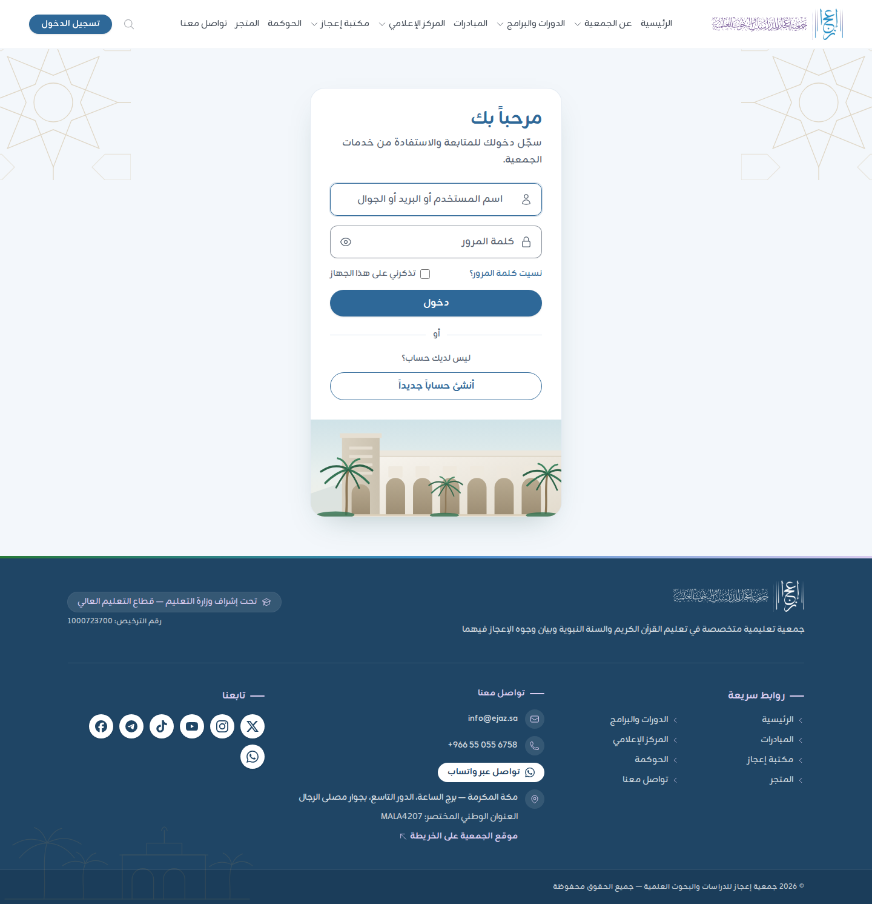

### كل دخول بعد ذلك

1. ادخل ببريدك وكلمة المرور كما سبق.
2. تظهر صفحة «التحقق الثنائي». اكتب في «رمز التحقق» الأرقام الستة الظاهرة في التطبيق الآن، واضغط «تحقق».
3. تفتح لوحة الإدارة على الرابط `/admin`.

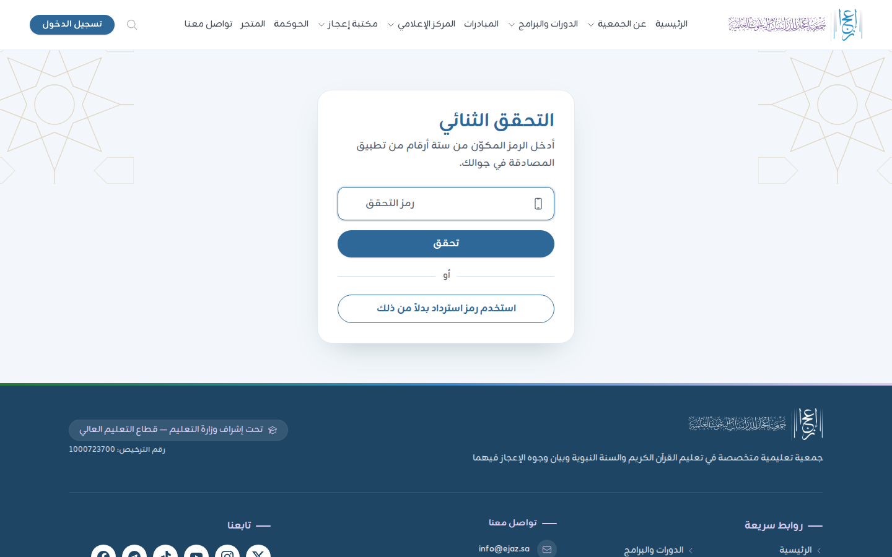

إن فقدت جوالك فاضغط في صفحة «التحقق الثنائي» «استخدم رمز استرداد بدلاً من ذلك» واكتب أحد رموز الاسترداد. ثم فعّل التطبيق على الجوال الجديد من «الأمان».

- تُغلق جلسة اللوحة آلياً بعد 30 دقيقة بلا نشاط، فاحفظ عملك قبل أن تبتعد عن الجهاز.
- كل ما تفعله في اللوحة يُسجَّل باسمك في «سجل العمليات». لا تشارك حسابك مع أحد.

---

## 2. رئيسية لوحة الإدارة

1. بعد الدخول تفتح «لوحة التحكم».
2. في أعلاها بطاقة «المدير التنفيذي (الأدمين)»، وفيها روابط: «إدارة الموظفين»، و«إدارة البرامج»، و«إدارة المسابقات»، و«إدارة الملفات».
3. تحتها: «المستندات ذات الصلاحية»، و«إنجاز الخطة السنوية»، ثم إحصائيات البوابة ورسم «الزيارات في آخر 30 يوماً».
4. القائمة الجانبية في اليمين. القسمان اللذان يكثر استعمالهما في هذا الدليل:
   - «الإعدادات»: «محتوى الرئيسية»، و«إعدادات الموقع»، و«قنوات التواصل»، و«ربط تيمز»، و«بطاقات لوحة المستفيد».
   - «المركز الإعلامي»: «الأخبار»، و«الإعلانات»، و«مكتبة الصور»، و«الشركاء»، و«البث المباشر».
5. «عرض الموقع» في أعلى القائمة يفتح الموقع العام لتتأكد من النتيجة.

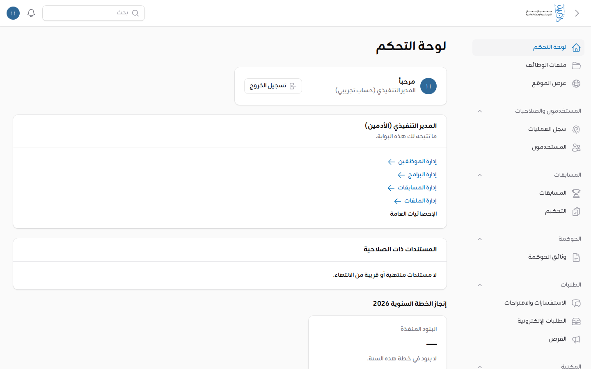

الإحصائيات تُحسب في الخلفية كل عشر دقائق. وإن ظهر «تُحسب الإحصائيات في الخلفية، وتظهر بعد دقائق.» فانتظر قليلاً.

---

## 3. محتوى الرئيسية والتذييل والشعار

كل نصوص الصفحة الرئيسية وصورها، ونصوص التذييل، والشعار، تُعدَّل من صفحة واحدة.

### تعديل نص أو صورة في الرئيسية

1. افتح «الإعدادات» ثم «محتوى الرئيسية».
2. الصفحة مقسمة إلى أقسام بترتيب ظهورها في الموقع:
   - «كلمة خادم الحرمين الشريفين».
   - «كلمة رئيس مجلس الإدارة»: «المقتطف في الرئيسية» يظهر في الصفحة، و«الكلمة كاملة» تظهر عند «اقرأ الكلمة كاملة». في «الكلمة كاملة» اكتب كل فقرة في سطر.
   - «المبررات».
   - «قيم الجمعية»: لكل قيمة «اسم القيمة» و«وصفها» و«الصورة».
   - «عناوين الواجهة ومقدماتها»: عنوانا شريطي الأخبار والإعلانات، وعنوان «قنوات التواصل» ومقدمتها، وعنوان صفحة الإعلانات ومقدمتها.
   - «التذييل».
   - «الشعار والمخطوطة».
3. عدّل النص في خانته.
4. لتبديل صورة: اسحبها إلى خانة «الصورة» أو اضغط «تصفح». الصيغ: jpg أو png أو webp حتى 6 ميجابايت. واكتب «النص البديل للصورة» (ما يقرؤه قارئ الشاشة للمكفوفين).
5. لإرجاع الصورة الأصلية: احذف الصورة المرفوعة واترك الخانة فارغة.
6. اضغط «حفظ» أسفل الصفحة، ثم افتح «عرض الموقع» وتأكد من النتيجة.

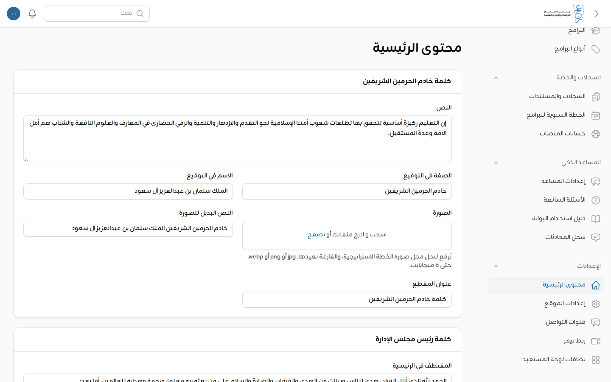

**وسم «مثال تجريبي»:** بعض المقدمات كتبها فريق البوابة مؤقتاً، ويظهر عليها في الموقع وسم «مثال تجريبي». يزول الوسم حين تكتب نص الجمعية المعتمد في الخانة وتحفظ. وإن حفظت الصفحة والنص كما هو فالوسم يبقى.

### التذييل

1. في «محتوى الرئيسية» انزل إلى قسم «التذييل».
2. الخانات: «نبذة الجمعية»، و«جهة الإشراف»، و«رقم الترخيص»، و«عنوان الروابط المختصرة»، و«عنوان التواصل»، و«عنوان القنوات»، و«نص الحقوق».
3. عدّل واضغط «حفظ».

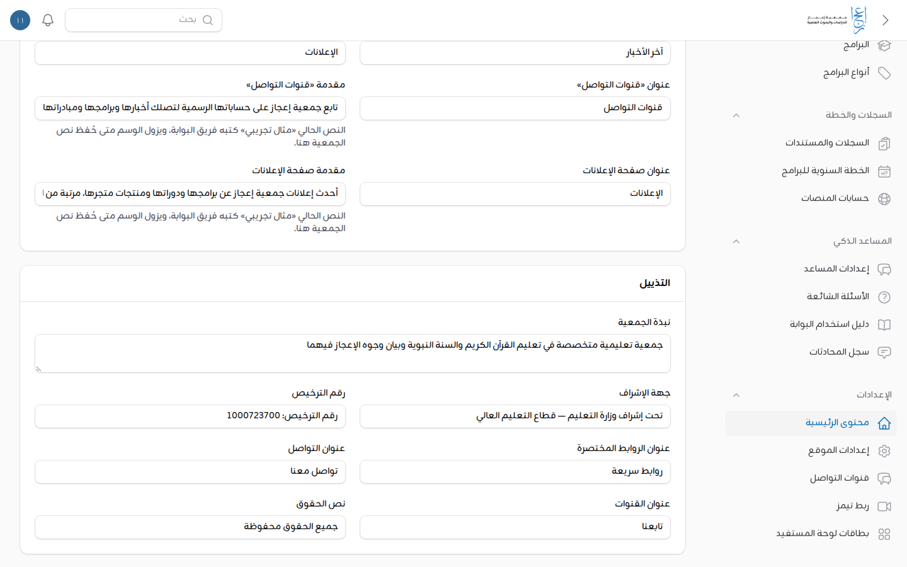

أما البريد والهاتف والعنوان وحسابات التواصل في التذييل فتأتي من «إعدادات الموقع» (القسم 10 أدناه). وروابط التذييل المختصرة تتبع «القائمة الرئيسية» في قسم «المحتوى».

### الشعار والمخطوطة

1. في «محتوى الرئيسية» انزل إلى قسم «الشعار والمخطوطة».
2. أربع خانات:
   - «الشعار بأعمدته (للخلفية الفاتحة)».
   - «الشعار بأعمدته (أبيض للخلفية الداكنة)».
   - «مخطوطة الاسم (للخلفية الفاتحة)».
   - «مخطوطة الاسم (بيضاء للخلفية الداكنة)».
3. ارفع الملف: png أو webp **بخلفية شفافة**، حتى 2 ميجابايت.
4. اضغط «حفظ». يتغير الشعار في الرأس والتذييل وقسم المبررات معاً.
5. لإرجاع الملف الحالي: احذف المرفوع واحفظ.

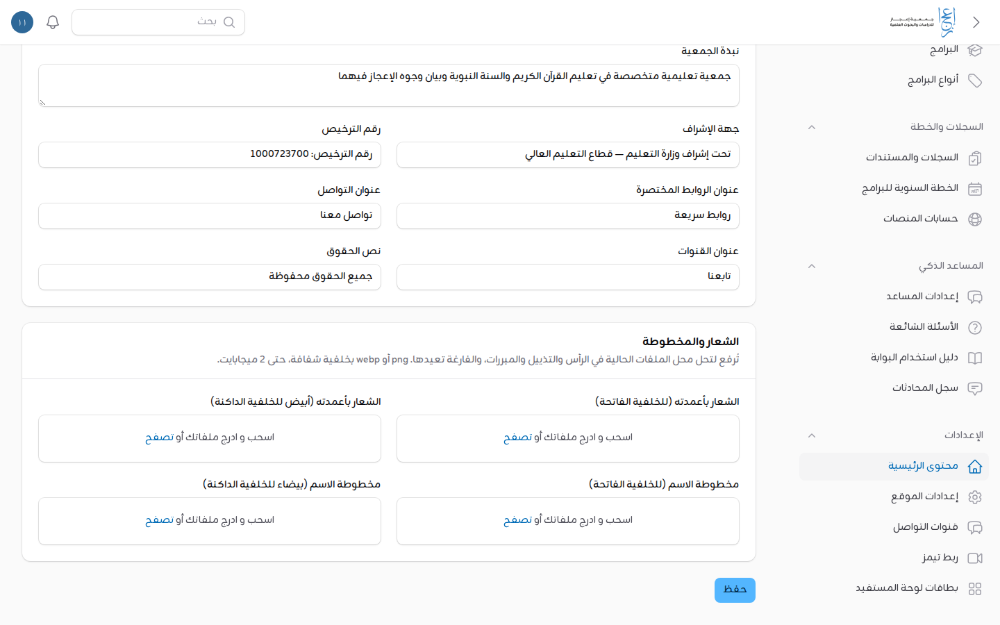

### إظهار المقاطع وإخفاؤها

ترتيب الرئيسية ثابت (الكلمتان، ثم المبررات، ثم القيم). أما المقاطع الإضافية فتُظهر وتُخفى من «إعدادات الموقع» ← تبويب «الرئيسية» ← «المقاطع الظاهرة»: «شريط آخر الأخبار»، و«شريط الإعلانات»، و«قنوات التواصل»، ومقاطع الموقع السابق. فعّل المفتاح أو أطفئه، ثم «حفظ».

شريط الإحصائيات في الرئيسية لا يظهر إلا بأرقام معتمدة من الجمعية، أو بأرقام البوابة الفعلية.

---

## 4. الإعلانات

الإعلانات تظهر في شريط الإعلانات بالرئيسية وفي صفحة الإعلانات، كل إعلان في مدة عرضه.

### إضافة إعلان

1. افتح «المركز الإعلامي» ثم «الإعلانات»، واضغط «إضافة إعلان».
2. اكتب «العنوان».
3. ارفع «الصورة»: PNG أو JPG أو WebP، والأنسب عرضية (4 إلى 3). لا تُقبل SVG.
4. اختر «نوع الإعلان»: «منتجات المتجر»، أو «البرامج»، أو «الدورات»، أو «عام». النوع يُستعمل لتصفية صفحة الإعلانات.
5. «الرابط» (اختياري): رابط كامل يبدأ بـ `https://`، أو مسار في البوابة يبدأ بـ `/`. اتركه فارغاً إن كان الإعلان صورة بلا رابط. وإعلان «منتجات المتجر» بلا رابط يفتح متجر الجمعية.
6. «يظهر من» و«يختفي بعد»: مدة العرض. يختفي الإعلان آلياً بعدها.
7. فعّل «منشور».
8. اضغط «إضافة».

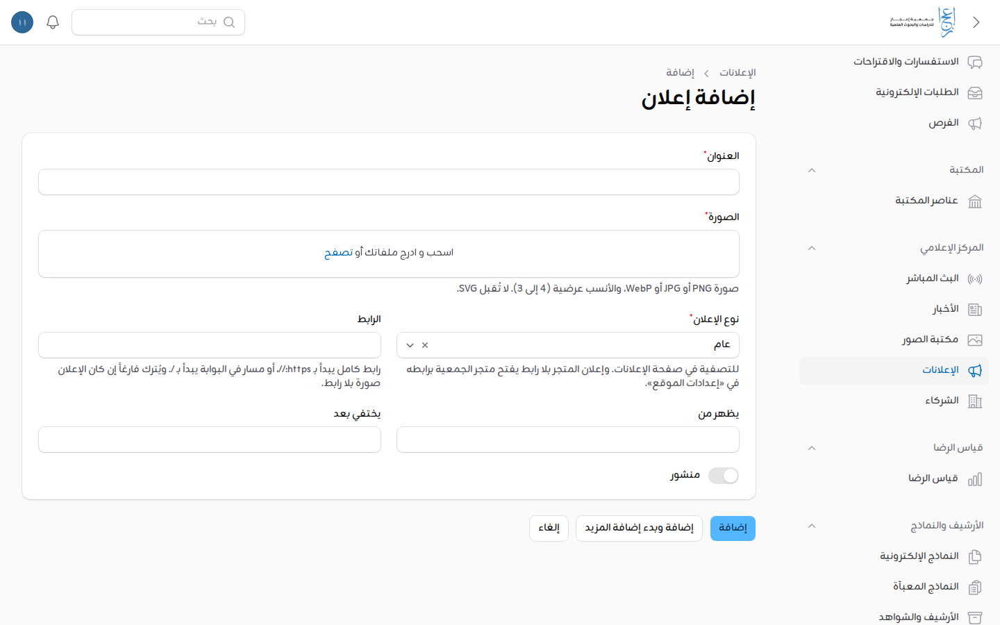

لإيقاف إعلان قبل موعده: افتحه بـ«تعديل»، وأطفئ «منشور»، واحفظ.

---

## 5. مكتبة إعجاز

للمكتبة أربعة أقسام: «المكتبة المرئية»، و«المكتبة الصوتية»، و«الكتب والمؤلفات»، و«الأبحاث والدراسات».

### إضافة عنصر

1. افتح «المكتبة» ثم «عناصر المكتبة»، واضغط «إضافة عنصر».
2. اكتب «العنوان».
3. «المعرّف في الرابط»: حروف لاتينية صغيرة وأرقام وشرطات، مثل `qiyam`. يظهر في رابط الصفحة، فاختره قصيراً واضحاً.
4. اختر «القسم». تتغير الخانات بحسبه:
   - **المرئية والصوتية:** «رابط يوتيوب». الصق رابط المقطع من يوتيوب. لا تُرفع ملفات فيديو ولا صوت إلى البوابة.
   - **الكتب والأبحاث:** «الملف (PDF)» حتى 20 ميجابايت.
5. اكتب «المؤلف أو المتحدث» و«تاريخ النشر» و«الوصف».
6. «التصنيفات»: حتى عشرة. اختر من التصنيفات المقترحة ما أمكن، فلا يتكرر التصنيف بصيغتين.
7. «الصورة المصغرة» (اختيارية): JPG أو PNG أو WebP حتى 4 ميجابايت. وإن تُركت فارغة في مقطع يوتيوب فالبوابة تجلب صورته المصغرة بنفسها.
8. فعّل «منشور». لا يُنشر عنصر بلا رابط مقطع أو ملف.
9. اضغط «إضافة».

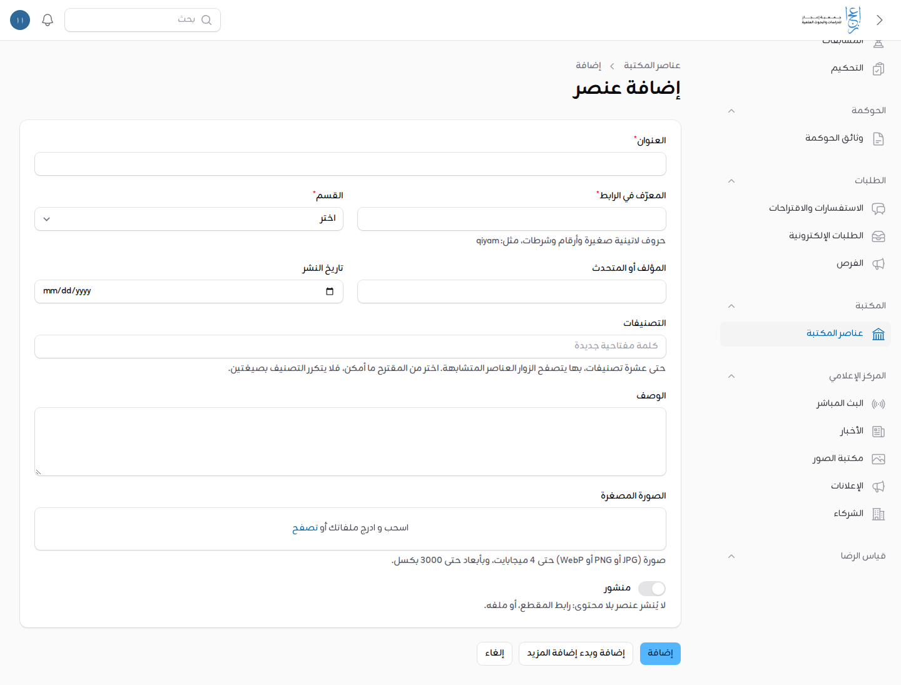

المقطع يظهر للزائر بصورته، ولا يعمل إلا إذا ضغط عليه، مع تنبيه بأن يوتيوب تسري عليه سياسة خصوصية جوجل.

---

## 6. الأخبار

### إضافة خبر

1. افتح «المركز الإعلامي» ثم «الأخبار»، واضغط «إضافة خبر».
2. اكتب «العنوان» و«المعرّف في الرابط» (حروف لاتينية صغيرة وأرقام وشرطات).
3. حدّد «تاريخ النشر»، واختر «التصنيف» من المستعمل ما أمكن.
4. اكتب «الملخص»، وارفع «صورة الغلاف» (JPG أو PNG أو WebP حتى 4 ميجابايت).
5. نص الخبر: اضغط «إضافة إلى المحتوى» واختر «نص» أو «صورة» أو «بطاقات»، وكرر لكل فقرة أو صورة.
6. «معرض الصور» (اختياري): صور إضافية تظهر أسفل الخبر.
7. فعّل «منشور»، واضغط «إضافة».

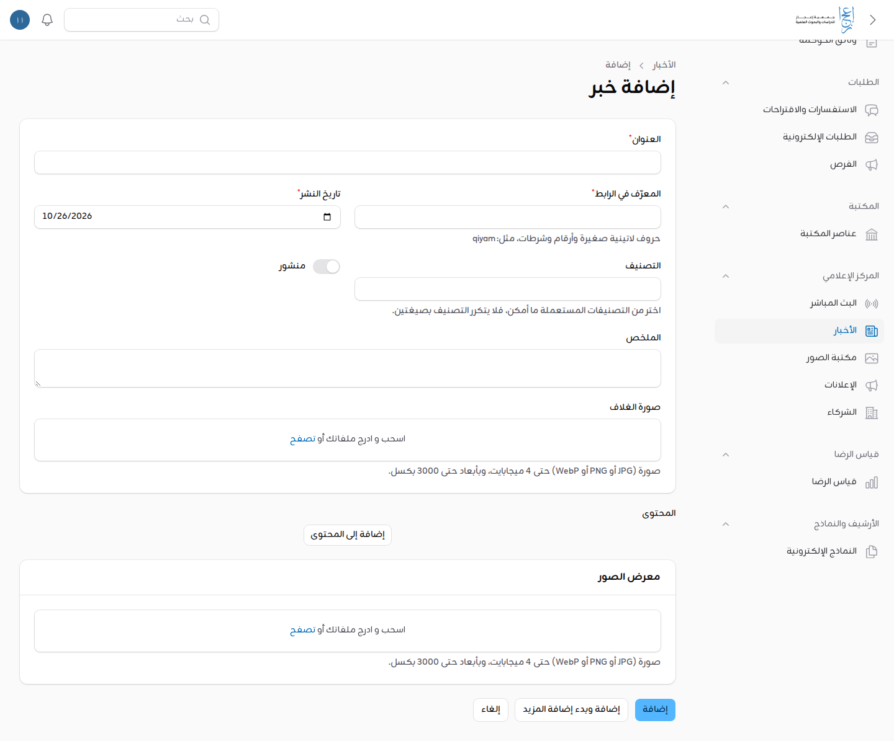

الخبر المنشور يظهر في المركز الإعلامي، وفي شريط آخر الأخبار بالرئيسية إن كان الشريط ظاهراً.

---

## 7. بطاقات لوحة المستفيد

البطاقات التي يراها صاحب الحساب في «حسابي» تُدار من «الإعدادات» ثم «بطاقات لوحة المستفيد».

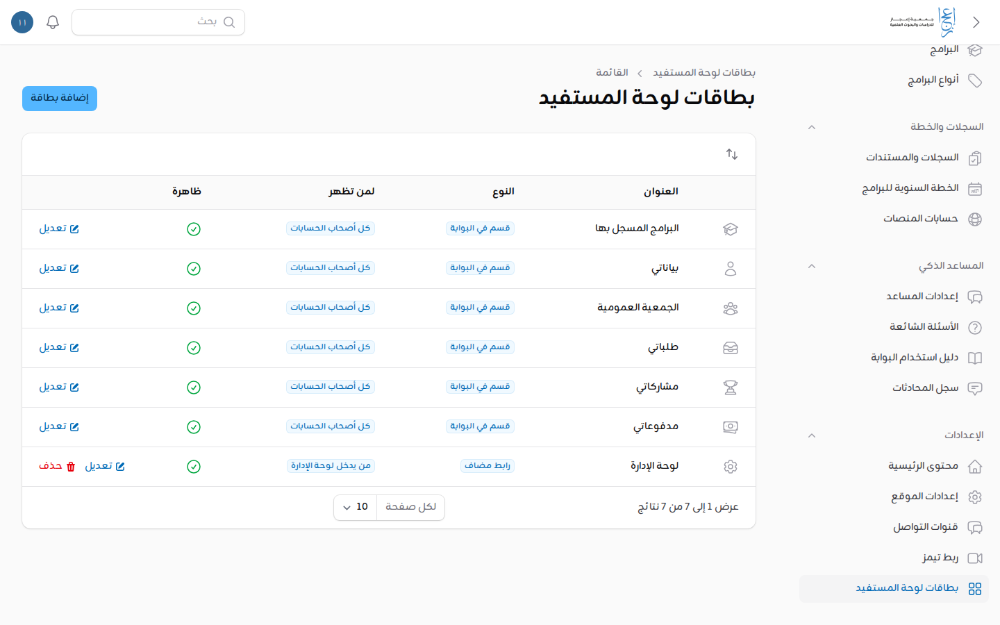

- **بطاقات الأقسام** («قسم في البوابة»): مثل «البرامج المسجل بها» و«بياناتي» و«طلباتي». تُعدَّل وتُخفى وتُرتَّب، ولا تُحذف. وتظهر لمن له صلاحية قسمها وحده.
- **البطاقات المضافة** («رابط مضاف»): تنشئها أنت، وتُحذف.

### تعديل بطاقة أو إخفاؤها

1. اضغط «تعديل» في صف البطاقة.
2. غيّر «العنوان» أو «الوصف» أو «الأيقونة»، أو أطفئ «ظاهرة» لإخفائها.
3. احفظ.
4. لتغيير الترتيب: اضغط سهمي الترتيب أعلى الجدول، واسحب الصفوف.

### إضافة بطاقة جديدة

1. اضغط «إضافة بطاقة».
2. اكتب «العنوان» و«الوصف»، واختر «الأيقونة».
3. «الرابط»: مسار في البوابة يبدأ بـ `/`، أو رابط كامل يبدأ بـ `https://`.
4. «لمن تظهر»: «كل أصحاب الحسابات»، أو «من يدخل لوحة الإدارة»، أو «أدوار مختارة» ثم اختر الأدوار.
5. فعّل «ظاهرة»، واضغط «إضافة».

---

## 8. المستخدمون والأدوار وإعادة كلمة المرور

افتح «المستخدمون والصلاحيات» ثم «المستخدمون». ابحث بالاسم أو اسم المستخدم أو البريد أو الجوال، وصفِّ بـ«الأدوار» و«الحساب مفعّل».

### إنشاء حساب موظف أو صاحب دور

1. اضغط «إضافة مستخدم».
2. اكتب «الاسم» و«البريد الإلكتروني»، و«الجوال» إن وُجد.
3. اختر «الأدوار». تملك منح الأدوار كلها، وعضوية الجمعية العمومية تُدار من «سجل الأعضاء».
4. اضغط «إضافة». **لا تكتب كلمة مرور:** يصل صاحب الحساب بريد «أُنشئ لك حساب في بوابة جمعية إعجاز» فيعيّنها بنفسه.
5. إن كان الدور يدخل لوحة الإدارة فأخبره أن التحقق الثنائي شرط لدخوله.

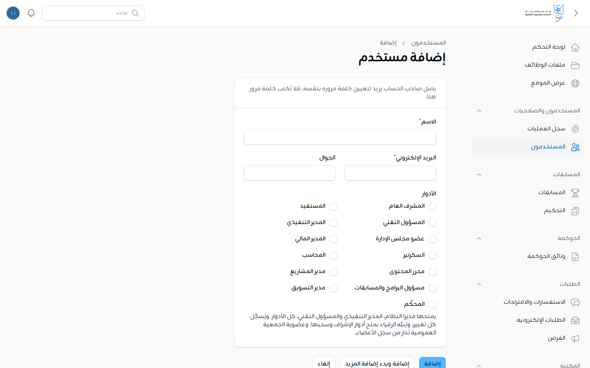

إن لم يصل البريد أو انتهى الرابط ولم يدخل صاحبه بعد: اضغط «إعادة إرسال الدعوة» في صفه. يبطل الرابط السابق.

### تغيير الأدوار أو إيقاف حساب

1. اضغط «تعديل» في صف الحساب.
2. غيّر «الأدوار»، أو أطفئ «الحساب مفعّل» لمنع صاحبه من الدخول.
3. احفظ. كل تغيير في الأدوار يُسجَّل، ومنح أدوار الإشراف أو سحبها يُنبَّه به المشرف العام ومديرا النظام.

لا تستطيع سحب دورك الإداري من نفسك ولا إيقاف حسابك، حتى لا تبقى البوابة بلا من يديرها.

### طلبات حذف الحسابات

1. في «المستخدمون» افتح التصفية واختر «طلب حذف بانتظار المعالجة».
2. راجع الطلب، ثم اضغط «معالجة طلب الحذف» في صف الحساب.
3. يُستبدل الاسم والبريد، ويُحذف الجوال والأدوار والتحقق الثنائي، ويوقف الحساب. **لا يمكن التراجع عن ذلك.**

### إعادة كلمة المرور لمن لا يستطيع استعادتها بنفسه

من سجّل باسم مستخدم بلا بريد موثق ولا جوال موثق لا يستطيع استعادة كلمة مروره من الموقع، فيطلبها من الجمعية.

1. تحقق من هوية صاحب الطلب. 【ناقص: إجراء الجمعية للتحقق من هوية من يطلب كلمة مرور مؤقتة (مثلاً ولي الأمر أو المدرسة)】
2. ابحث عن حسابه باسم المستخدم.
3. اضغط «كلمة مرور مؤقتة» في صفه، ثم «تأكيد».
4. تظهر رسالة «عُيّنت كلمة المرور المؤقتة» وفيها الكلمة. **انسخها فوراً**، فلن تظهر مرة أخرى.
5. سلّمها لصاحب الحساب بطريقة آمنة.
6. عند دخوله بها تطلب البوابة منه تغييرها قبل أي شيء آخر. وتنتهي جلساته المفتوحة على الأجهزة الأخرى.

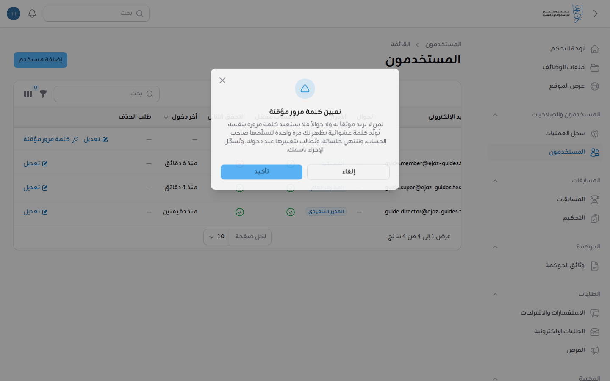

الزر لا يظهر لحساب له بريد موثق أو جوال موثق (يستعيد بنفسه من «نسيت كلمة المرور؟»)، ولا لحسابات المشرف العام ومديري النظام.

---

## 9. إعدادات الموقع: التوثيق والأقسام المؤجلة

افتح «الإعدادات» ثم «إعدادات الموقع»، ثم تبويب «الحسابات». فيه مفتاحان مطفآن بقرار المدير التنفيذي، يُفعَّلان متى قُرّر ذلك:

- **«اشتراط توثيق البريد أو الجوال»:**
  - إن فُعّل: يصل رابط التوثيق بعد التسجيل، ويلزم بريد موثق أو جوال موثق للتسجيل في البرامج وتقديم الطلبات، وتُحذف الحسابات المتروكة غير الموثقة.
  - إن أُطفئ (الوضع الحالي): لا شيء من ذلك، ويبقى التوثيق اختيارياً لمن أراد استعادة كلمة مروره بنفسه.
- **«إظهار بوابات مجلس الإدارة والموظفين والجمعية العمومية»:** بطاقتا «مجلس الإدارة» و«الموظفون» في رئيسية اللوحة، و«الجمعية العمومية» في حساب المستخدم. مخفية الآن، والصلاحيات باقية كما هي.

خطوات التغيير:

1. فعّل المفتاح أو أطفئه.
2. اضغط «حفظ».

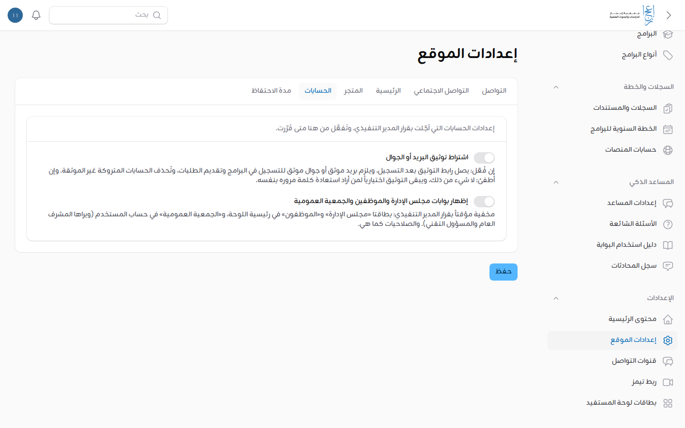

قبل تفعيل التوثيق تأكد أن البريد والرسائل النصية تعمل في الخادم، وإلا لم تصل رسائل التوثيق.

---

## 10. البيانات الرسمية للجمعية

البريد والهاتف وواتساب والعنوان والعنوان الوطني وحسابات التواصل الاجتماعي تظهر في التذييل وصفحة «تواصل معنا»، وتُعدَّل من مكان واحد.

1. افتح «الإعدادات» ثم «إعدادات الموقع»، تبويب «التواصل».
2. الخانات:
   - «البريد الإلكتروني».
   - «الهاتف».
   - «رقم واتساب»: جوال سعودي يبدأ بـ 05، ومنه زر واتساب في التذييل وصفحة «تواصل معنا».
   - «العنوان».
   - «العنوان الوطني المختصر»: أربعة أحرف إنجليزية وأربعة أرقام، مثل ABCD1234.
   - «رابط الخريطة»: يبدأ بـ `https://`. وإن تُرك فارغاً فالرابط يُبنى من العنوان الوطني المختصر.
3. اضغط «حفظ».
4. حسابات المنصات في تبويب «التواصل الاجتماعي»: إكس، وإنستغرام، ويوتيوب، ولينكد إن، وسناب شات، وتيك توك، وتلغرام، وفيسبوك، وواتساب. رابط الحساب كاملاً يبدأ بـ `https://`، ويُترك فارغاً إن لم يوجد، فيختفي شعاره.

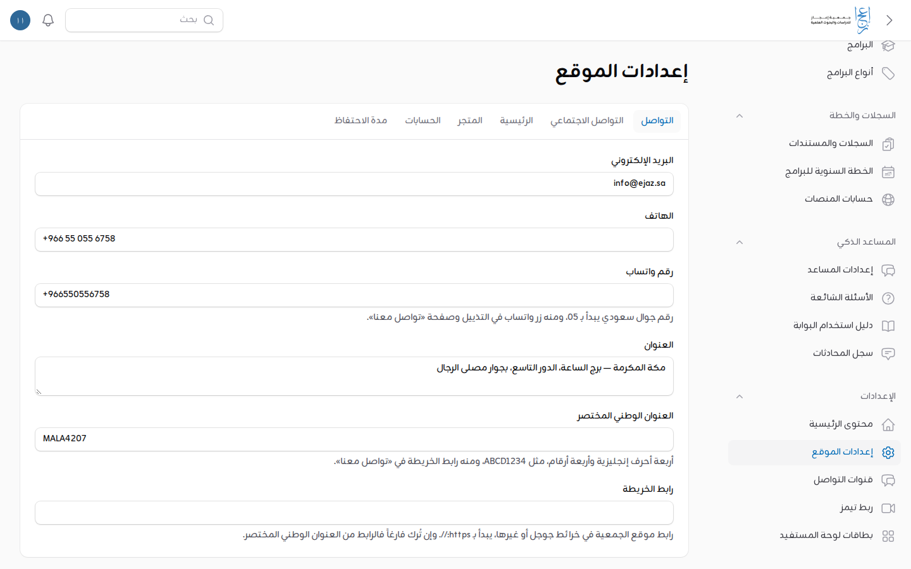

ورقم الترخيص ونبذة الجمعية وجهة الإشراف في «محتوى الرئيسية» ← «التذييل» (القسم 3).

لا تكتب بيانات غير معتمدة. ما لم تعتمده الجمعية يبقى فارغاً حتى يُعتمد.

---

## 11. البرامج والدورات

### إضافة برنامج

1. افتح «البرامج» ثم «البرامج»، واضغط «إضافة برنامج».
2. «البيانات الأساسية»: «العنوان»، و«النوع»، و«المبادرة المرتبطة»، و«الوصف المختصر»، و«التفاصيل»، و«الصورة».
3. «المواعيد والتنفيذ»: «موعد البدء»، و«موعد الانتهاء»، و«طريقة التنفيذ» (حضوري، أو عن بعد، أو مدمج)، و«المكان»، و«رابط الاجتماع (تيمز)» الذي يظهر للمسجلين المؤكدين وحدهم.
4. «التسجيل»: «عدد المقاعد» (فارغ لغير محدود)، و«فتح التسجيل» و«إغلاق التسجيل»، و«قائمة انتظار عند الامتلاء»، و«الفئة المستهدفة»، و«شروط التسجيل».
5. «حقول التسجيل الإضافية»: ما يملؤه المسجل. الاسم والبريد والجوال تؤخذ من حسابه، فلا تضفها.
6. اضغط «إضافة».

لا تنسخ أوصاف البرامج من مصادر غير معتمدة: النصوص الرسمية من الجمعية.

### المسجلون والحضور والتصدير

1. افتح البرنامج بـ«عرض». في أسفل الصفحة «المسجلون» بالاسم والحالة والحضور.
2. لتسجيل الحضور: حدد المسجلين بمربعات الاختيار، ثم اختر من الإجراءات الجماعية «تسجيل الحضور». وللتراجع «إلغاء الحضور». لا يُسجَّل الحضور قبل بدء البرنامج.
3. للتصدير اضغط «تصدير المسجلين». يصلك إشعار في اللوحة عند اكتمال الملف.

### أنواع البرامج

«البرامج» ثم «أنواع البرامج» لإضافة نوع («الاسم» و«الترتيب»). الأنواع تظهر تبويبات في صفحة «الدورات والبرامج» بالموقع.

---

## 12. المسابقات

خطوات إنشاء المسابقة وأسئلتها ومعاييرها وإسنادها للمحكّمين واعتماد نتائجها والسحب مفصّلة في [دليل لوحة الإدارة — المسابقات](admin-panel.md#المسابقات). وباختصار:

1. «المسابقات» ثم «إضافة مسابقة»: البيانات، ومعايير التقييم، وبنك الأسئلة، والمحكّمون.
2. انشرها بالحالة المناسبة. لا تُنشر مسابقة بلا أسئلة.
3. تابع الأرقام من «لوحة المتابعة» في صفحة المسابقة.
4. بعد الإغلاق: أسند المشاركات للمحكّمين، ثم «اعتماد النتائج»، ثم «تنفيذ السحب» إن كان في المسابقة سحب.

لا تستطيع تعديل أسئلة مسابقة بعد أول مشاركة فيها، ولا معاييرها بعد أول إسناد للمحكّمين.

---

## 13. الملفات: الأرشيف وملفات الوظائف

### الأرشيف والشواهد

1. افتح «الأرشيف والنماذج» ثم «الأرشيف والشواهد»، واضغط «إضافة عنصر أرشيف».
2. اختر «النوع» (وثيقة، أو مراسلة واردة، أو مراسلة صادرة، أو شاهد) و«التصنيف».
3. اكتب «العنوان» و«الجهة» و«التاريخ». واربطه بـ«البرنامج» إن كان شاهداً على برنامج.
4. ارفع «الملفات (PDF وصور)» واحفظ. المراسلات تأخذ «رقم القيد» آلياً.

ترى تصنيفات الأرشيف كلها، ومنها ملفات مجلس الإدارة. ومن يطّلع على كل تصنيف من الأدوار الأخرى تحدده أنت من «تصنيفات الأرشيف».

### ملفات الوظائف

ترى ملفات الوظائف كلها، وتنشئ ملفاً جديداً وتعدّل بياناته:

1. افتح «ملفات الوظائف»، واضغط «إضافة ملف وظيفة».
2. املأ الحقول: «اسم الملف»، و«الوصف»، و«الوظيفة المسؤولة»، و«الأيقونة»، و«الوظائف المشاركة»، و«يضيف المشاركون مستندات» (إن لم يُفعَّل يطّلع المشاركون فقط)، و«الترتيب».
3. احفظ.

مستندات كل ملف يضيفها ويعدّلها مسؤوله ومشاركوه. فلا تستطيع تعديل مستندات ملف ليس لوظيفتك فيه دور. ولا يُحذف ملف فيه مستندات.

---

## 14. الإحصائيات وقياس الرضا

- **في رئيسية اللوحة الإحصائيات.** تُحسب في الخلفية كل عشر دقائق، ويظهر تحت أولها «آخر تحديث». مجموعاتها:
  - «المستخدمون والزيارات»: الحسابات، وموثّقو الجوال، والحسابات الجديدة (30 يوماً)، ومشاهدات اليوم، وزوار اليوم.
  - «الزيارات في آخر 30 يوماً»: رسم المشاهدات والزوار الفريدين لكل يوم. وهو «عدّاد تقريبي يعدّ المتصفح لا الإنسان»، فيُقرأ اتجاهاً لا رقماً دقيقاً.
  - «الطلبات الإلكترونية»: المرسلة، ثم كل حالة بعددها، بلا المسودات.
  - «البرامج والمسابقات وقياس الرضا»: البرامج المنشورة، والتسجيلات المؤكدة، وقوائم الانتظار، والحضور المسجّل، والمسابقات ومشاركاتها، والاستبيانات وإجاباتها.
  - «الجمعية العمومية والأرشيف»: الأعضاء الفعّالون، واجتماعات الجمعية القادمة والمنعقدة، والنماذج المعبأة بحالتيها، وعناصر الأرشيف.
- **نتائج كل استبيان:** «قياس الرضا» ثم «النتائج»، ومنها التصدير.
- **أرقام كل مسابقة:** «لوحة المتابعة» في صفحتها.

---

## 15. السجلات والخطة السنوية وحسابات المنصات

### السجلات والمستندات ذات الصلاحية

1. افتح «السجلات والخطة» ثم «السجلات والمستندات»، واضغط «إضافة مستند».
2. املأ «النوع» (مستند رسمي، أو عقد، أو ترخيص، أو شراكة، أو ملك، أو استثمار، أو موافقة نشاط، أو تصريح)، و«العنوان»، و«الجهة»، و«رقم المستند»، و«المسؤول».
3. «تاريخ الإصدار» و«تاريخ الانتهاء» (آخر يوم صالح، وفارغ لما لا ينتهي)، و«التنبيه قبل الانتهاء (أيام)».
4. ارفع «المرفقات (PDF أو صور)» واحفظ.

يصل «المسؤول» بريد عند اقتراب الانتهاء وعند الانتهاء. ولضبط المدة الافتراضية للتنبيه اضغط «مدة التنبيه الافتراضية» في رأس القائمة.

### الخطة السنوية للبرامج

1. افتح «السجلات والخطة» ثم «الخطة السنوية للبرامج»، واضغط «إضافة بند في الخطة».
2. املأ «السنة»، و«الإدارة»، و«النوع»، و«البرنامج أو النشاط»، و«تقسيم الهدف»، و«الموازنة التقديرية»، و«الفئة المستهدفة»، و«عدد المستفيدين المستهدف»، و«الجهات المساندة»، و«فترة الإعداد»، ومدة التنفيذ.
3. عند التنفيذ اربط «البرنامج المنفذ» وسجّل «المستفيدون الفعليون». تظهر النسبة في «إنجاز الخطة السنوية» بالرئيسية.

### حسابات المنصات

«السجلات والخطة» ثم «حسابات المنصات»: «الجهة أو المنصة»، و«المسؤول»، و«اسم المستخدم»، و«رابط الدخول».

**لا تُكتب كلمات المرور هنا أبداً.** تُحفظ في مدير كلمات المرور المعتمد خارج البوابة. 【ناقص: اسم مدير كلمات المرور المعتمد لدى الجمعية】

### معاني الحالات

- البرنامج: «قريباً»، «مفتوح»، «مكتمل» (امتلأت المقاعد)، «منتهٍ».
- تسجيل المستفيد: «مؤكد»، «في قائمة الانتظار»، «ملغى».
- المسابقة: «مسودة» (لا تظهر في الموقع)، «قريباً»، «مفتوحة»، «مكتملة».
- المشاركة: «مسودة»، «مرسلة».
- النموذج المعبأ: «مسودة»، «معتمد».
- المستند ذو الصلاحية: «صالح»، «قارب على الانتهاء»، «منتهٍ»، «بلا انتهاء».

---

## 16. ما لا يُفعل وأين تطلب المساعدة

- **لا تنشر** نصاً رسمياً أو رقماً لم تعتمده الجمعية.
- **لا تشارك** كلمة المرور ولا رموز التحقق ولا رموز الاسترداد. ولا تعطِ كلمة مرور مؤقتة إلا لصاحب الحساب نفسه.
- **عند مغادرة موظف** أوقف حسابه فوراً بإطفاء «الحساب مفعّل».
- **عضوية الجمعية العمومية** تُدار من «سجل الأعضاء» لمديري النظام، لا بالأدوار: العضوية الفعّالة تمنح الدور، وغيرها تسحبه.
- **ما ليس لك:** اعتماد المحاضر والنماذج المعبأة، فهو لمجلس الإدارة.
- **إعدادات المزوّدين** («قنوات التواصل» و«ربط تيمز» و«إعدادات المساعد») يتولاها المسؤول التقني عادة. وأدلتها: [قنوات التواصل](messaging.md)، و[ربط تيمز](teams-meetings.md)، و[المساعد الذكي](ai-assistant.md).
- **الدعم الفني للبوابة:** 【ناقص: اسم جهة الدعم الفني وطريقة التواصل معها وأوقات الاستجابة】
