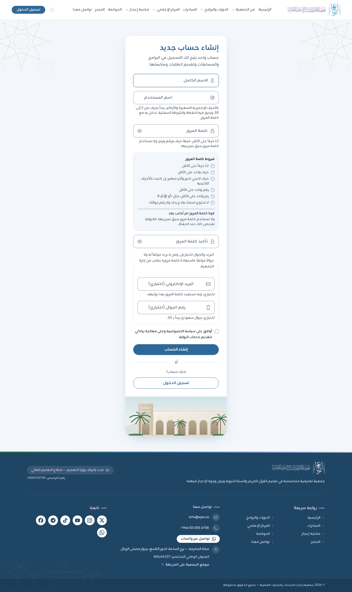
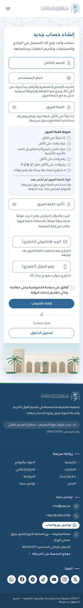
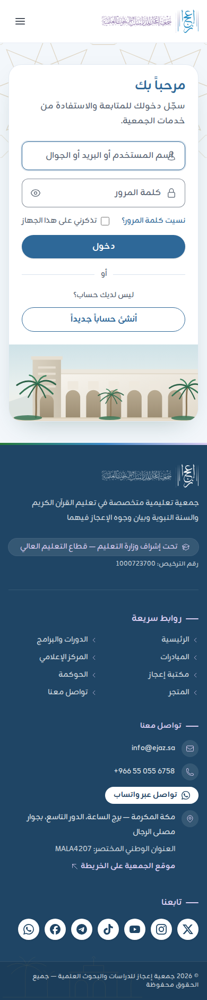
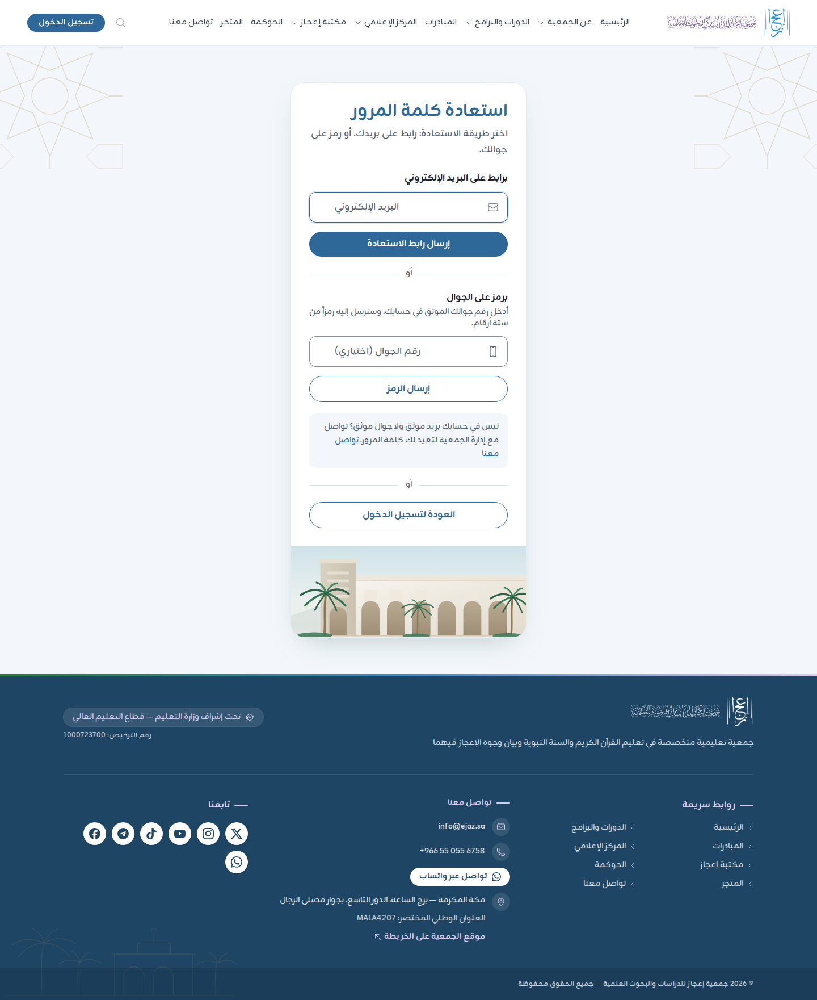
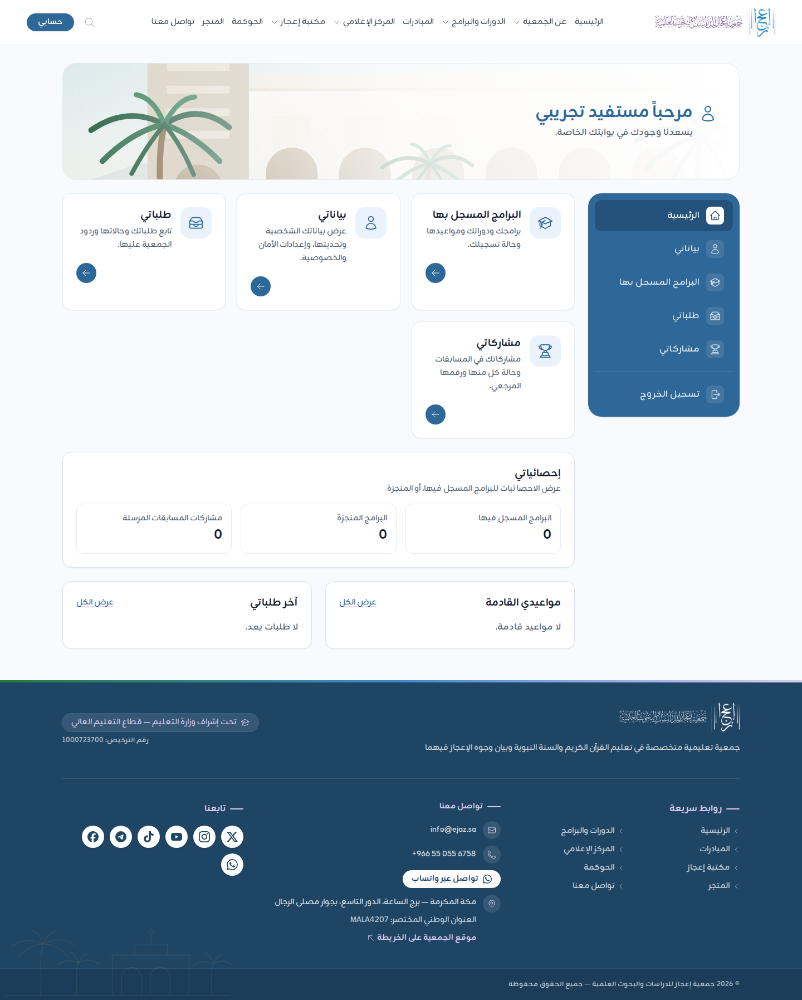
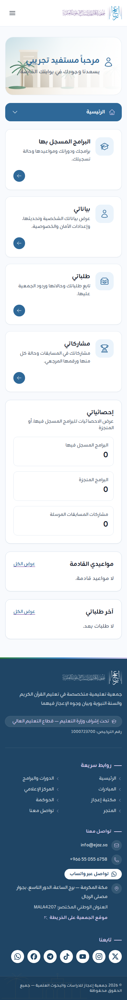
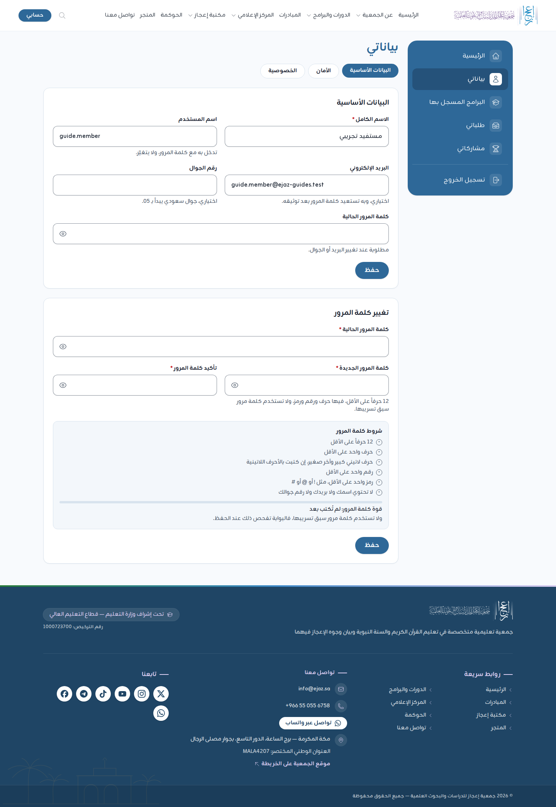

# دليل المستفيد

لكل من يريد حساباً في بوابة جمعية إعجاز: للتسجيل في البرامج والدورات والمسابقات، وتقديم الطلبات ومتابعتها.

اللقطات في هذا الدليل من نسخة محلية من البوابة بحساب تجريبي.

## 1. إنشاء حساب باسم المستخدم

يكفي لإنشاء الحساب **الاسم الكامل واسم المستخدم وكلمة المرور**. البريد والجوال اختياريان.

1. افتح الموقع واضغط «تسجيل الدخول» أعلى الصفحة، ثم «إنشاء حساب جديد» (أو افتح `/register` مباشرة).
2. **«الاسم الكامل»:** اكتب اسمك كما تحب أن يظهر في شهاداتك ومراسلاتك.
3. **«اسم المستخدم»:** هو ما تدخل به مع كلمة المرور، ولا يتغيّر بعد إنشاء الحساب. شروطه:
   - أحرف إنجليزية صغيرة وأرقام، ويجوز فيه النقطة `.` والشرطة السفلية `_`.
   - يبدأ بحرف، وطوله من 3 إلى 30.
   - مثال: `ahmad.ali` أو `sara_2010`.
   - إن ظهر أنه غير متاح فاختر اسماً آخر.
4. **«كلمة المرور»:** 12 حرفاً على الأقل، فيها:
   - حرف واحد على الأقل، وإن كتبت بالأحرف اللاتينية فحرف كبير وآخر صغير.
   - رقم واحد على الأقل.
   - رمز واحد على الأقل، مثل `!` أو `@` أو `#`.
   - لا تحتوي اسمك ولا بريدك ولا رقم جوالك ولا اسم المستخدم.
   - لا تكون كلمة مرور سبق تسريبها. البوابة تفحص ذلك عند الحفظ.

   تحت الخانة قائمة «شروط كلمة المرور» يُعلَّم فيها كل شرط حين يتحقق وأنت تكتب، وشريط «قوة كلمة المرور».
5. **«تأكيد كلمة المرور»:** أعد كتابتها.
6. **«البريد الإلكتروني»** و**«رقم الجوال»** (اختياريان): بهما تستعيد كلمة المرور بنفسك إن نسيتها، بعد توثيقهما. الجوال سعودي يبدأ بـ 05.
7. ضع علامة على «أوافق على سياسة الخصوصية وعلى معالجة بياناتي لتقديم خدمات البوابة.».
8. اضغط «إنشاء الحساب».

**مهم:** إن لم تضف بريداً ولا جوالاً موثقاً فلن تستطيع استعادة كلمة المرور بنفسك، وستحتاج إلى طلبها من إدارة الجمعية. احفظ اسم المستخدم وكلمة المرور في مكان آمن.

على الجوال الصفحة نفسها بعمود واحد:

## 2. الدخول

1. اضغط «تسجيل الدخول» أعلى الصفحة (أو افتح `/login`).
2. اكتب في «اسم المستخدم أو البريد أو الجوال» أياً منها.
3. اكتب «كلمة المرور».
4. فعّل «تذكرني على هذا الجهاز» على جهازك الشخصي وحده، لا على جهاز مشترك أو جهاز معمل.
5. اضغط «تسجيل الدخول». تفتح لوحتك «حسابي».

إن فعّلت التحقق الثنائي في حسابك فستُطلب بعد كلمة المرور الأرقام الستة من تطبيق المصادقة في جوالك.

### رسائل قد تظهر

- «بيانات الدخول غير صحيحة.»: راجع اسم المستخدم وكلمة المرور. الرسالة لا تذكر أيهما الخطأ عمداً لحماية الحساب.
- «محاولات دخول كثيرة. حاول مرة أخرى بعد … ثانية.»: انتظر المدة ثم أعد المحاولة.
- طلب تغيير كلمة المرور فور الدخول: إما أن شروط كلمة المرور تغيّرت وكلمتك لا تطابقها، أو أن الإدارة عيّنت لك كلمة مرور مؤقتة. اكتب كلمة مرور جديدة في «تغيير كلمة المرور» واحفظ، ثم تابع.

## 3. استعادة كلمة المرور

1. في صفحة الدخول اضغط «نسيت كلمة المرور؟».
2. اختر الطريقة:
   - **«برابط على البريد الإلكتروني»:** اكتب بريدك واضغط «إرسال رابط الاستعادة»، ثم افتح الرسالة واضغط «تعيين كلمة مرور جديدة». الرابط صالح مدة محدودة مكتوبة في الرسالة.
   - **«برمز على الجوال»:** اكتب رقم جوالك واضغط «إرسال الرمز»، ثم اكتب «رمز التحقق» الذي يصلك (صالح عشر دقائق) وكلمة المرور الجديدة.
3. ادخل بكلمة المرور الجديدة.

- الاستعادة تعمل **للبريد الموثق أو الجوال الموثق وحده**. والرد في الصفحة واحد سواء وُجد الحساب أم لا، لحماية الحسابات.
- **ليس في حسابك بريد موثق ولا جوال موثق؟** تواصل مع إدارة الجمعية من صفحة «تواصل معنا». تعطيك كلمة مرور مؤقتة، وتطلب منك البوابة تغييرها عند أول دخول. 【ناقص: ما يطلبه موظف الجمعية للتحقق من هوية صاحب الحساب قبل إعطائه كلمة مرور مؤقتة】

## 4. لوحتك «حسابي»

- **الترحيب** باسمك أعلى الصفحة.
- **البطاقات:**
  - «البرامج المسجَّل فيها»: برامجك ودوراتك ومواعيدها وحالة تسجيلك.
  - «بياناتي»: بياناتك الشخصية وتحديثها، وإعدادات الأمان والخصوصية.
  - «طلباتي»: طلباتك وحالاتها وردود الجمعية عليها.
  - «مشاركاتي»: مشاركاتك في المسابقات وحالة كل منها ورقمها المرجعي.

  اضغط دائرة السهم في البطاقة لفتح قسمها. والبطاقات تحددها إدارة الجمعية، فقد تختلف قليلاً عما في الصورة.
- **«إحصائياتي»:** البرامج المسجل فيها، والبرامج المنجزة، ومشاركات المسابقات المرسلة.
- **«مواعيدي القادمة»** و**«آخر طلباتي»**، ولكل منهما «عرض الكل».
- **القائمة الجانبية** في اليمين، و«تسجيل الخروج» في أسفلها.

على الجوال تصير القائمة الجانبية زراً منسدلاً أعلى الصفحة باسم القسم الحالي، والبطاقات عموداً واحداً:

## 5. «بياناتي»

في «بياناتي» ثلاثة تبويبات: «البيانات الأساسية»، و«الأمان»، و«الخصوصية».

### البيانات الأساسية وتغيير كلمة المرور

1. عدّل «الاسم الكامل» أو أضف «البريد الإلكتروني» أو «رقم الجوال». «اسم المستخدم» ظاهر ولا يتغيّر.
2. عند تغيير البريد أو الجوال اكتب «كلمة المرور الحالية».
3. اضغط «حفظ».
4. لتوثيق البريد أو الجوال اضغط «وثّق بريدك» أو «وثّق جوالك» بجانبه:
   - **البريد:** يصلك رابط، افتحه.
   - **الجوال:** يصلك رمز من ستة أرقام، اكتبه في «رمز التحقق» واضغط «توثيق».
5. لتغيير كلمة المرور: في «تغيير كلمة المرور» اكتب «كلمة المرور الحالية» ثم الجديدة وتأكيدها، واحفظ.

التوثيق اختياري الآن، وفائدته أن تستعيد كلمة المرور بنفسك.

### الأمان

- تفعيل التحقق الثنائي (اختياري ومستحسن). الخطوات في [فهرس الأدلة](README.md#التحقق-الثنائي).
- «الأجهزة الأخرى»: تسجيل الخروج من الأجهزة التي دخلت منها.

تطلب البوابة كلمة المرور قبل فتح «الأمان» («تأكيد كلمة المرور»)، لأنها منطقة حساسة.

### الخصوصية

- «تنزيل نسخة من بياناتي»: ملف بصيغة JSON فيه بيانات حسابك وما سجلته في البوابة.
- «طلب حذف الحساب»: اكتب «كلمة المرور الحالية» واضغط «أرسل طلب الحذف». يراجع فريق الجمعية الطلب، ثم تُحذف بياناتك الشخصية إلا ما يلزم الاحتفاظ به نظاماً.

## 6. نصائح

- لا تشارك كلمة المرور ولا رموز التحقق مع أحد. الجمعية لا تطلبها منك.
- سجّل الخروج بعد الانتهاء، خاصة على الأجهزة المشتركة.
- للمساعدة: صفحة «تواصل معنا» (`/contact`)، وفيها نموذج «الاستفسارات والاقتراحات».

للمسابقات انظر [دليل الطالب في المسابقة](competition-student.md)، وللبرامج والطلبات تفصيل أكثر في [دليل المشتركين والمستفيدين](members.md).
