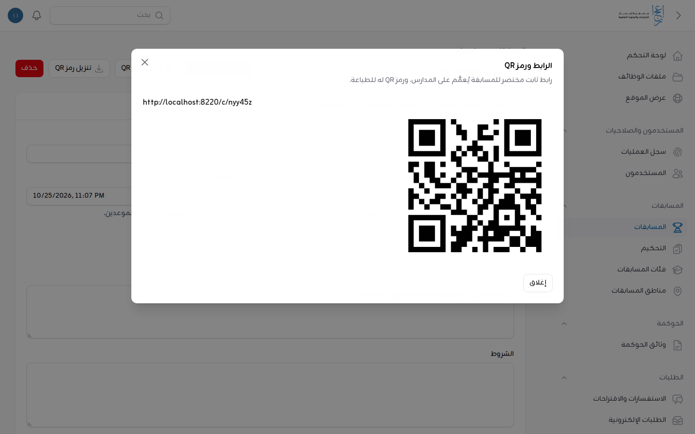
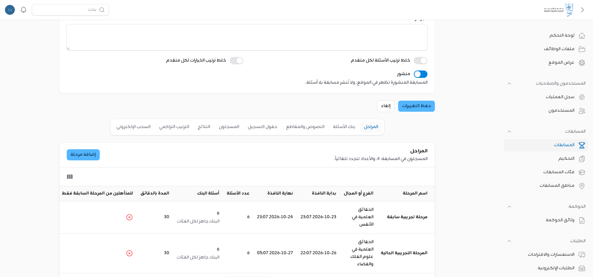
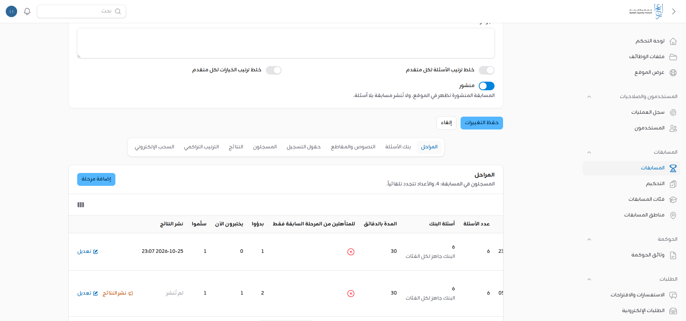
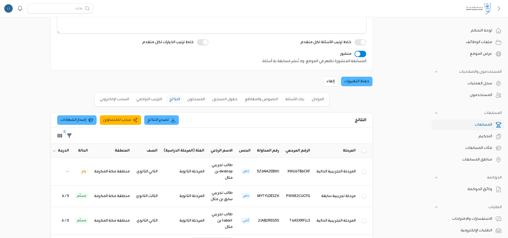
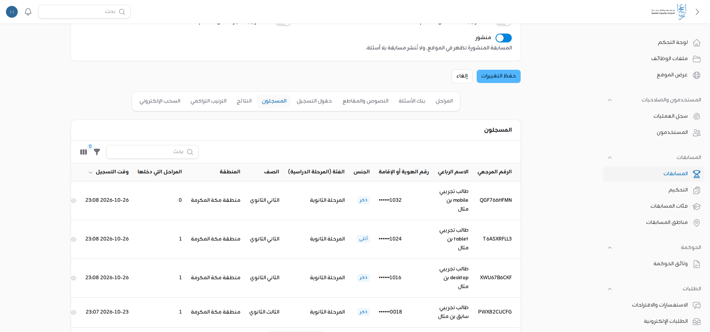
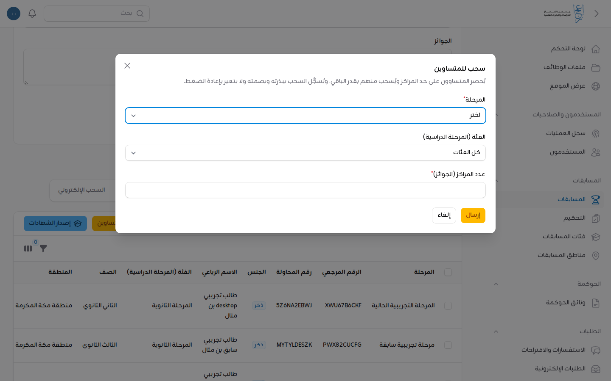
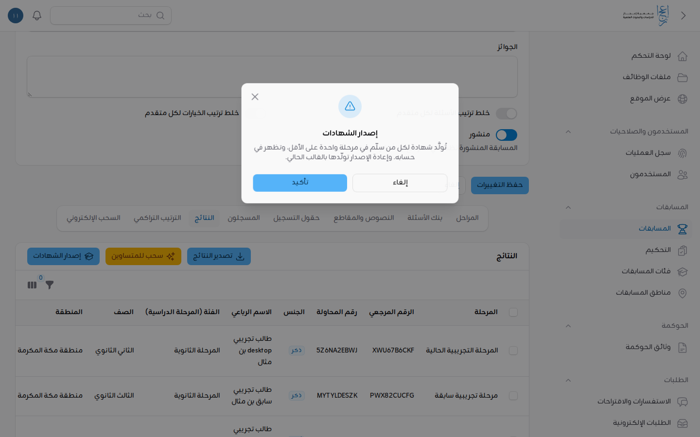

# دليل تشغيل يوم المسابقة

للمدير التنفيذي والمسؤول التقني. ما يُفعل قبل كل فرع (يوم الخميس) وأثناءه وبعده في مسابقة الطلاب، مثل «مسابقة البراهين العلمية». وإعداد المسابقة من أولها (المراحل، والبنك، والحقول) في [دليل مسابقة إعجاز للطلاب](competition.md).

كل ما هنا من «المسابقات» ← المسابقة ← «تعديل»، وفي أسفل صفحتها تبويبات: «المراحل»، و«بنك الأسئلة»، و«النصوص والمقاطع»، و«حقول التسجيل»، و«المسجلون»، و«النتائج»، و«الترتيب التراكمي»، و«السحب الإلكتروني».

اللقطات من نسخة محلية بمسابقة وطلاب تجريبيين، وأرقام الهوية فيها مُولَّدة للاختبار.

## المحتويات

1. [قبل الفرع](#1-قبل-الفرع)
2. [أثناء الفرع](#2-أثناء-الفرع)
3. [بعد الفرع](#3-بعد-الفرع)
4. [ما لا يُفعل](#4-ما-لا-يُفعل)
5. [ما ينتظر قرار الجمعية](#5-ما-ينتظر-قرار-الجمعية)

---

## 1. قبل الفرع

### قبل أسبوع: الرابط ورمز QR

1. في أعلى صفحة المسابقة اضغط «الرابط ورمز QR». يظهر رابط مختصر ثابت للمسابقة (`/c/` وحروف قصيرة) ورمزه.
2. **قبل التنزيل:** تأكد مع المسؤول التقني أن الرابط يبدأ بعنوان الموقع النهائي (`https://ejaz.sa`). الرمز يُبنى من عنوان الخادم، والرمز المطبوع بعنوان آخر لا يصلحه تغيير لاحق.
3. اضغط «تنزيل رمز QR»، وأرسل الرابط والرمز لإدارة النشاط الطلابي لتعميمهما على المدارس.

الرابط واحد للفروع الأربعة، فلا يُعمَّم رابط جديد كل أسبوع.

### قبل يومين: المراحل والبنك

1. افتح تبويب «المراحل». لكل فرع صف فيه: «بداية النافذة» و«نهاية النافذة»، و«عدد الأسئلة»، و«أسئلة البنك»، و«المدة بالدقائق»، و«للمتأهلين من المرحلة السابقة فقط».
2. **النافذة:** تأكد من يوم الخميس وساعتي البداية والنهاية بتوقيت الرياض. لا يدخل طالب قبل البداية، ولا يبدأ بعد النهاية.
3. **المدة:** عداد كل طالب يبدأ حين يضغط «ابدأ الاختبار». والمدة تنتهي مع نهاية النافذة إن كانت أقرب، فاجعل النافذة أطول من المدة بوقت كافٍ لدخول المدارس على دفعات.
4. **«للمتأهلين…»:** يبقى مطفأً في البراهين العلمية (كل طالب يشارك في الفروع الأربعة)، إلا بقرار مكتوب من الجمعية.
5. **«أسئلة البنك»:** تحت العدد سطر واحد:
   - «البنك جاهز لكل الفئات»: جاهز.
   - «لا يكوّن البنك عدد الأسئلة تماماً لهذه الفئات: …»: أضف أسئلة للفئة المذكورة في «بنك الأسئلة»، أو قلّل «عدد الأسئلة».
   - «البنك أكبر من العدد ودرجات أسئلته مختلفة: وحّدها»، أو «الدرجة القصوى تختلف بين الفئات»: وحّد «الدرجة» في أسئلة الفرع.

   ما دام السطر غير «جاهز» فطلاب الفئة المذكورة لا يبدؤون، ويرون «الاختبار غير جاهز…».

6. **بعد أن يبدأ أول طالب** يُقفل الفرع: لا تتغير بدايته ولا عدد أسئلته ولا مدته ولا بنكه ونصوصه. ويبقى تعديل الاسم ومد النهاية. فراجع كل شيء قبل البداية.
7. تأكد أن «منشور» مفعّل في بيانات المسابقة، وأن «الفئات المفتوحة في هذا الإطلاق» صحيحة.

### للمسؤول التقني: الخادم

- **المجدول يعمل:** مهمة كل دقيقة تُسلّم آلياً محاولات من انتهى وقته ولم يعد (`ejaz:close-expired-attempts`). وبدون المجدول تبقى تلك المحاولات «جارية» ولا تدخل النتائج. افحص بـ `php artisan ejaz:health` (ومنه نبض المجدول) صباح الخميس.
- **بعد كل نشر للبوابة** يُشغَّل `php artisan ejaz:refresh-content`، فيُعاد حساب جاهزية بنوك المراحل. والخطوات في `deploy.md`.
- **حدود شبكة المدرسة:** في أيام الاختبار وحدها (فرع جارٍ، أو يبدأ خلال ساعة) يتسع حد الدخول للعنوان الواحد: 300 دخول خاطئ في ربع ساعة، و900 محاولة دخول في الدقيقة. وهي قيم البيئة الافتراضية (`COMPETITION_WINDOW_LOGIN_*`). والحد لكل حساب لا يتغير.
- لا نشر للبوابة ولا ترحيل يوم الخميس في نافذة الاختبار.

---

## 2. أثناء الفرع

### المتابعة الحية

1. افتح تبويب «المراحل». في أعلاه «المسجلون في المسابقة»، وفي صف الفرع ثلاثة أعداد تتجدد تلقائياً كل خمس عشرة ثانية:
   - «بدؤوا»: من ضغط «ابدأ الاختبار».
   - «يختبرون الآن»: من بدأ ولم يُسلّم ووقته باقٍ.
   - «سلّموا»: بأنفسهم أو آلياً.
2. الأعمدة الثلاثة في آخر الجدول. إن لم تظهر فمرّر الجدول أفقياً.

**لا تعتمد صفحة «متابعة» المسابقة** (زر «لوحة المتابعة») في مسابقة الطلاب الآن: تعدّ المشاركات القديمة لا محاولات الطلاب، فتُظهر المكتملين صفراً. 【ناقص: إصلاح صفحة المتابعة لمسابقة الطلاب (الملاحظة 9 في تقرير الاختبار الشامل 0.14)】

### المحاولات العالقة

- محاولة «جارية» انتهى وقتها لأن الطالب أغلق المتصفح أو انقطع اتصاله: **لا تفعل شيئاً.** يسلّمها المجدول آلياً خلال دقيقة، وتظهر في النتائج «تسليم آلي» بما حفظه الطالب.
- إن بقي «يختبرون الآن» أكبر من الواقع بعد انتهاء المدد بدقائق، فالمجدول متوقف: أبلغ المسؤول التقني فوراً.
- لا يوجد في اللوحة تمديد لوقت طالب ولا إعادة محاولة له.

### دعم طالب انقطع اتصاله

اطلب من الطالب أو رائد النشاط ما يلي، بالترتيب:

1. يدخل بحسابه مرة أخرى، من الجهاز نفسه أو غيره، ويفتح صفحة المسابقة.
2. يقرأ ما بجانب فرع اليوم:
   - «أكمل الاختبار»: يضغطه ويكمل من حيث توقف، في **الوقت الباقي**. إجاباته المحفوظة باقية.
   - «تم استلام إجاباتك»: سُلّمت، فلا يبدأ من جديد. والضغط عليه يفتح «حالة المحاولة».
3. للتحقق من جهتك: تبويب «النتائج»، وابحث بالاسم. الحالة «جارٍ» أو «مسلَّم»، ومعها «رقم المحاولة».

والإرشادات التي بيد الطالب والمدرسة في [دليل الطالب](competition-student.md) و[دليل رواد النشاط](competition-schools.md).

### إعادة كلمة المرور

- **من له بريد موثق أو جوال موثق:** يستعيدها بنفسه من «نسيت كلمة المرور؟».
- **من سجّل باسم مستخدم بلا بريد ولا جوال موثق:**
  1. افتح «المستخدمون»، وابحث باسم المستخدم.
  2. اضغط «كلمة مرور مؤقتة»، ثم «تأكيد».
  3. انسخ الكلمة من الرسالة فوراً، فلا تظهر مرة أخرى.
  4. سلّمها لصاحب الحساب. يغيّرها عند دخوله ثم يكمل.

  التفصيل في [دليل المدير التنفيذي والمسؤول التقني](admin-executive-director.md#إعادة-كلمة-المرور-لمن-لا-يستطيع-استعادتها-بنفسه). 【ناقص: ما تطلبه الجمعية للتحقق من هوية الطالب قبل إعطائه كلمة مرور مؤقتة يوم الاختبار】

### تسجيل بيانات خاطئة

تبويب «المسجلون»:

- **«تصحيح التسجيل»:** الاسم، والفئة، والصف، والمنطقة، مع «السبب». والفئة لا تتغير بعد أن يبدأ الطالب اختباراً، لأن أسئلته ودرجته القصوى من بنكها.
- **«إلغاء التسجيل»:** يخرج التسجيل من النتائج، ويُفك رقم الهوية فيسجّل به صاحبه الحقيقي إن حُجز بغير حق. ويُسجَّل السبب ومن ألغى.
- رقم الهوية في الجدول مخفي إلا آخر أربعة أرقام. و«عرض رقم الهوية» يُسجَّل في سجل العمليات، فلا تفتحه إلا لحاجة.

---

## 3. بعد الفرع

بالترتيب. لا تبدأ بخطوة قبل انتهاء التي قبلها.

### أ) نشر النتائج

1. انتظر **نهاية النافذة**، ثم دقائق حتى تُسلَّم آلياً محاولات من بدأ في آخرها.
2. في «المراحل» اضغط «نشر النتائج» في صف الفرع، واقرأ التنبيه، ثم أكّد.
3. تظهر الدرجات للطلاب في حساباتهم. **لا تراجع عن النشر.**

يرفض النشر قبل نهاية النافذة، أو وطلاب ما زالوا في وقتهم: «ما زال طلاب في وقت اختبارهم في هذه المرحلة. انشر النتائج بعد انتهاء أوقاتهم.»

### ب) التأهيل (إن كان الفرع التالي للمتأهلين وحدهم)

لا يلزم في البراهين العلمية. وإن قررته الجمعية:

1. تبويب «النتائج»، وصفِّ بالفرع.
2. حدد الطلاب، ثم من الإجراءات الجماعية «تأهيل للمرحلة التالية». و«إلغاء التأهيل» للتصحيح.
3. التأهيل بعد نشر النتائج وحده، لأنه يكشفها.

### ج) السحب عند التساوي

عند إعلان الجوائز، بعد نشر النتائج:

- **لفرع واحد:** «النتائج» ← «سحب للمتساوين». اختر «المرحلة»، و«الفئة (المرحلة الدراسية)» (أو «كل الفئات»)، و«عدد المراكز (الجوائز)»، ثم «إرسال».
- **للترتيب النهائي في البراهين العلمية:** بعد نشر نتائج الفروع الأربعة، «الترتيب التراكمي» ← «سحب للمتساوين في الترتيب التراكمي» لكل جنس. وعدد المراكز من جدول الجوائز. ولا يدخل الترتيب إلا من شارك في كل الفروع.

**قبل الضغط تأكد من عدد المراكز:**
- السحب يُسجَّل مرة واحدة لكل فرع وفئة (أو لكل جنس في التراكمي) بعدد مراكزه، ببذرته وبصمة قائمته.
- إعادة الضغط تعرض النتيجة نفسها، وطلبه بعدد آخر يُرفض.
- وإن وقع خطأ ففي «السحب الإلكتروني» «إلغاء السحب» بسبب مكتوب يُسجَّل، **مرة واحدة**. وما بعدها قرار مكتوب من الجمعية لا إعادة سحب.

إن لم يكن تساوٍ على حد المراكز ظهر «لا تساوي على حد المراكز، فلا حاجة للسحب.»

### د) الشهادات

1. تأكد أن «قالب الشهادة» المعتمد من الجمعية مرفوع في بيانات المسابقة. 【ناقص: قالب الشهادة المعتمد من الجمعية】 بدونه يرفض الموقع الحقيقي الإصدار: «ارفع قالب الشهادة المعتمد في المسابقة قبل إصدار الشهادات.» (والقالب المؤقت للتجربة في النسخ المحلية وحدها).
2. «النتائج» ← «إصدار الشهادات» ← «تأكيد».
3. تُولَّد شهادة لكل من سلّم في فرع واحد على الأقل، وتظهر في حسابه خلال دقائق.
4. إن بدّلت القالب فأعد الإصدار.

### هـ) التصدير

- «تصدير النتائج» بالتصفية الحالية، و«تصدير الترتيب التراكمي». رقم الهوية فيهما مخفي إلا آخر أربعة أرقام، إلا لمن يملك الاطلاع الكامل.
- الملف فيه بيانات شخصية: احفظه في مكان آمن، واحذفه بعد استعماله.

---

## 4. ما لا يُفعل

- **لا تعدّل الفرع بعد أن يبدأ أول طالب**، إلا الاسم ومد النهاية. والبنك مقفل حينها حفاظاً على عدالة الإجابات.
- **لا تقدّم نهاية النافذة** والطلاب يختبرون.
- **لا تنشر النتائج قبل نهاية النافذة**، ولا تنشر فرعاً بالخطأ: النشر لا يُتراجع عنه.
- **لا تنفّذ السحب قبل التأكد من عدد المراكز والفئة.**
- **لا تُصدر الشهادات قبل رفع قالب الجمعية المعتمد**، ولا تُعِد الإصدار بلا سبب.
- **لا تفتح «عرض رقم الهوية»** بلا حاجة، فكل اطلاع يُسجَّل باسمك.
- **لا تنشر البوابة ولا تُرحّل قاعدتها** يوم الخميس أثناء النافذة.
- **لا تطبع رمز QR** قبل التأكد من أن الرابط على عنوان الموقع النهائي.
- **لا تُعطِ كلمة مرور مؤقتة** إلا لصاحب الحساب بعد التحقق منه.
- **المشرف العام اطلاع فقط:** يرى المسابقة ومراحلها ونتائجها، ولا ينشر ولا يسحب ولا يصدّر.

---

## 5. ما ينتظر قرار الجمعية

- **نطاق الترتيب والجوائز:** (أ) العشرة الأوائل لكل جنس من كل الفئات معاً كما في المطوية، وهو الافتراضي في «الجوائز والترتيب». (ب) لكل جنس في كل فئة. 【ناقص: قرار المدير التنفيذي في نطاق الترتيب】 ولا يتغير النطاق بعد السحب في الترتيب التراكمي أو نشر نتائج كل الفروع.
- **حد الدخول لكل عنوان شبكة يوم الاختبار:** القيم الحالية (300 دخول خاطئ في ربع ساعة، و900 محاولة في الدقيقة) افتراضية من البيئة، ولم تُقس على أكبر مدرسة. 【ناقص: أكبر عدد طلاب يدخلون معاً من مدرسة واحدة، لضبط الحد】
- **التساوي بين مراكز الجوائز نفسها** (مثل الثالث والرابع بمبلغين مختلفين): السحب المبني على حد المراكز وحده. 【ناقص: قرار الجمعية في التساوي داخل المراكز】
- **مواعيد الفروع الأربعة** وقالب الشهادة والتحقق من الهوية قبل كلمة المرور المؤقتة: في `open-questions.md`.
