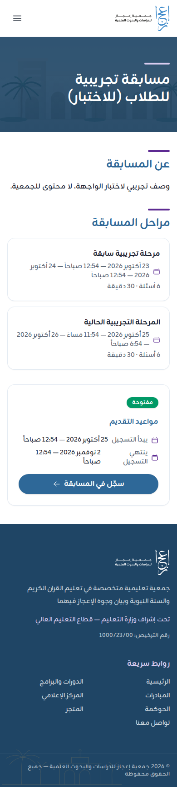
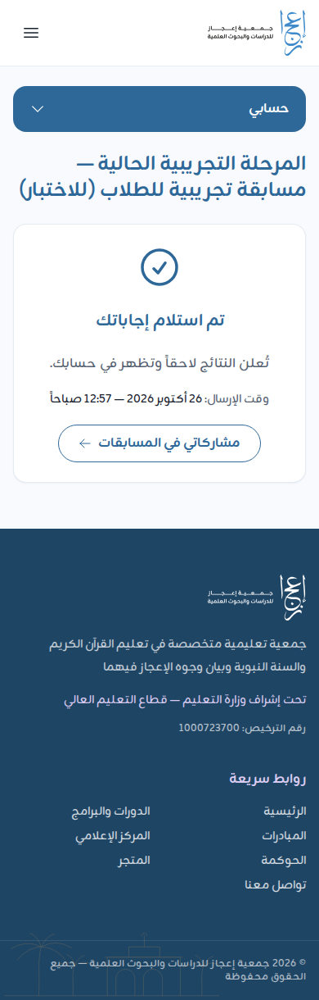
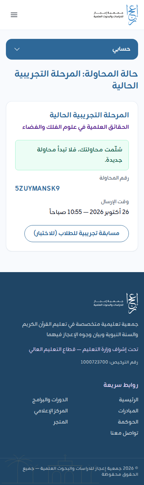

# دليل رواد النشاط في المدارس: تنفيذ مسابقة البراهين العلمية

لرواد النشاط والمعلمين الذين يشرفون على دخول الطلاب إلى اختبار «مسابقة البراهين العلمية» في المدرسة. ودليل الطالب نفسه في [دليل الطالب](competition-student.md)، فاطبعه أو أرسله لطلابك.

## آلية التنفيذ في المدارس (من مطوية الجمعية)

- تُنفَّذ المسابقة **كل يوم خميس لمدة أربعة أسابيع متتالية**. ويُدخل إليها من خلال الرابط الرسمي الصادر من موقع الجمعية، والذي يُعمَّم على المدارس من خلال إدارة النشاط الطلابي.
- تنفّذ المدارس المسابقة من خلال **معامل الحاسب الآلي** للطلاب الحاضرين يوم الخميس، أو بأي آلية أخرى تراها المدرسة مناسبة وفق الإمكانات المتاحة.
- يشرف رواد النشاط والمعلمون على دخول الطلاب للرابط وتنفيذ الاختبار.

مواعيد الأيام الأربعة وساعات الاختبار: 【ناقص: تواريخ أيام الخميس الأربعة وساعة البداية والنهاية، تعلنها الجمعية】

## 1. الرابط ورمز QR

- يصلك من إدارة النشاط الطلابي **رابط مختصر** للمسابقة، يبدأ بعنوان موقع الجمعية ثم `/c/` وحروف قصيرة، و**رمز QR** يفتح الرابط نفسه. 【ناقص: الرابط الرسمي المختصر ورمز QR عند إطلاق المسابقة】
- الرابط ثابت للمسابقة كلها: الأسابيع الأربعة تُدخل من الرابط نفسه. وفي صفحة المسابقة الفروع الأربعة، وزر «ادخل الاختبار» يظهر لفرع اليوم في وقته وحده.
- **في معمل الحاسب:** افتح الرابط مسبقاً في متصفح كل جهاز، أو اكتبه على السبورة.
- **على جوالات الطلاب:** اعرض رمز QR على الشاشة أو اطبعه، فيمسحه الطالب بكاميرا جواله.
- لا تنشر الرابط خارج المدرسة إلا كما تعمّمه الجمعية، ولا تستعمل رابطاً من مصدر آخر.

## 2. قبل أول خميس: الحسابات والتسجيل

كل طالب يحتاج **حساباً خاصاً به** في البوابة، و**تسجيلاً واحداً** في المسابقة. والأفضل أن يُنجز ذلك قبل يوم الاختبار الأول، فلا يضيع وقت الاختبار فيه.

1. يُنشئ كل طالب حسابه باسم مستخدم وكلمة مرور ([دليل المستفيد](beneficiary.md#1-إنشاء-حساب-باسم-المستخدم)). البريد والجوال اختياريان.
2. ينبّه الطالب إلى **حفظ اسم المستخدم وكلمة المرور**: من لا بريد موثقاً له ولا جوالاً موثقاً لا يستعيد كلمة مروره بنفسه، بل من إدارة الجمعية.
3. يفتح الطالب رابط المسابقة، ويضغط «سجّل في المسابقة»، ويعبّئ «بيانات الطالب»: الاسم الرباعي، ورقم الهوية أو الإقامة، والفئة والصف، والجنس، والمنطقة، وجوال ولي الأمر (اختياري).
4. تأكد مع الطالب من صحة الاسم ورقم الهوية قبل «تسجيل»: البيانات لا يعدّلها الطالب بعد التسجيل، ورقم الهوية لا يُسجَّل إلا مرة.

إن أنشأ الطلاب حساباتهم من أجهزة المعمل: البوابة تتسع لكثرة إنشاء الحسابات من شبكة المدرسة الواحدة ما دام تسجيل المسابقة مفتوحاً، وحدّ الجهاز الواحد **40 حساباً جديداً في الساعة**. فوزّع الطلاب على الأجهزة، ولا تُنشئ عدداً كبيراً من الحسابات من جهاز واحد في ساعة واحدة.

## 3. تجهيز معمل الحاسب

قبل الخميس بيوم:

- تأكد من الاتصال بالإنترنت في المعمل، وأن موقع الجمعية يفتح من الأجهزة.
- استعمل متصفحاً حديثاً (Chrome أو Edge أو Firefox أو Safari بإصدار حديث).
- جرّب فتح الرابط من جهاز أو جهازين.
- أغلق في الأجهزة التطبيقات والصفحات غير الضرورية.
- جهّز قائمة بأسماء الطلاب المسجلين ليتابع المعلم من دخل ومن سلّم.

يوم الخميس:

1. **طالب واحد لكل جهاز في وقت واحد.**
2. يفتح كل طالب الرابط **في نافذة تصفح خاصة** (التصفح المتخفي)، ويدخل بحسابه هو.
3. لا يضع الطالب علامة على «تذكرني على هذا الجهاز» في جهاز المعمل.
4. يضغط «ادخل الاختبار» ثم «ابدأ الاختبار»، ويجيب، ثم «المراجعة» ثم «تسليم الإجابات».
5. **لا يغادر الطالب الجهاز حتى تظهر «تم استلام إجاباتك»** و«رقم المحاولة». يكتب المعلم رقم المحاولة بجانب اسم الطالب في القائمة، أو يلتقط الطالب صورة للشاشة.
6. بعد التسليم: يسجّل الطالب الخروج من «حسابي» ← «تسجيل الخروج»، ثم تُغلق نافذة التصفح الخاصة قبل أن يجلس الطالب التالي.

في أيام الاختبار تتسع البوابة لكثرة الدخول من شبكة المدرسة الواحدة، فلا يُمنع الطلاب لأنهم يدخلون معاً من عنوان واحد. ويبقى لكل حساب حد محاولات الدخول الخاطئة، فإن ظهر لطالب «محاولات دخول كثيرة» فلينتظر المدة المذكورة.

## 4. ما تفعله عند مشكلة

**الرابط لا يفتح**
- تحقق من الإنترنت في الجهاز، ثم أعد فتح الرابط من المتصفح.
- جرّب جهازاً آخر في المعمل. وإن تعذّر في كل الأجهزة فالمشكلة في شبكة المدرسة أو الموقع: تواصل مع الجمعية.

**الطالب لا يذكر كلمة المرور**
- إن كان في حسابه بريد أو جوال موثق: «نسيت كلمة المرور؟» في صفحة الدخول.
- وإلا: تواصل مع الجمعية باسم المستخدم. تعطيه كلمة مرور مؤقتة يغيّرها عند الدخول. 【ناقص: ما تطلبه الجمعية من المدرسة للتحقق من هوية الطالب قبل إعطائه كلمة مرور مؤقتة】

**«بيانات الدخول غير صحيحة.»**
- تأكد من اسم المستخدم: أحرف إنجليزية صغيرة، بلا مسافات.
- تأكد من حالة الأحرف في كلمة المرور ولغة لوحة المفاتيح.

**الأسئلة لا تظهر كاملة**
- جرّب متصفحاً آخر أو جهازاً آخر.

**انقطع الاتصال أو أُغلقت الصفحة أثناء الاختبار**
1. لا داعي للقلق: العداد يستمر، والإجابات المحفوظة باقية.
2. يدخل الطالب بحسابه مرة أخرى (من الجهاز نفسه أو غيره)، ويفتح صفحة المسابقة.
3. إن ظهر بجانب فرع اليوم «أكمل الاختبار» فليضغطه ويكمل في **الوقت الباقي**.
4. وإن ظهر «تم استلام إجاباتك» فقد سُلّمت محاولته، فلا يبدأ من جديد.
5. وإن انتهى الوقت قبل عودته فتُسلَّم إجاباته المحفوظة آلياً.

**ظهر «الاختبار غير جاهز لفئتك في هذه المرحلة بعد. راجع الجمعية.»**
- تواصل مع الجمعية فوراً، واذكر فئة الطالب ومرحلته.

**ظهر «هذه المرحلة للمتأهلين من المرحلة السابقة.»**
- هذا الفرع لمن تأهل من الفرع السابق وحده.

**بيانات الطالب في التسجيل خاطئة**
- لا يسجّل الطالب مرة أخرى بحساب آخر. تواصل مع الجمعية بالتصحيح المطلوب، فتصحّحه من لوحة الإدارة.

**الطالب لا يجد زر «ادخل الاختبار»**
- قبل الموعد يظهر «لم تبدأ بعد»، وبعد انتهاء الوقت «انتهت».
- تأكد أنه داخل بحسابه، وأنه مسجّل في المسابقة (يظهر في صفحتها «أنت مسجّل في المسابقة» ورقمه المرجعي).

## 5. التواصل مع الجمعية

- البريد: info@ejaz.sa
- الجوال وواتساب: 0550556758
- صفحة «تواصل معنا» في الموقع.
- 【ناقص: هل للمسابقة رقم دعم خاص للمدارس يوم الاختبار، واسم المسؤول، وساعات الرد】

عند التواصل اذكر: اسم المدرسة، واسم مستخدم الطالب (لا كلمة مروره)، والفرع، وما ظهر على الشاشة (ويُفضَّل صورة لها).

## 6. النتائج والشهادات

- لا تظهر الدرجة بعد التسليم. تُعلن النتائج لاحقاً، وتظهر في حساب كل طالب في «مشاركاتي».
- الترتيب النهائي والجوائز لمن شارك في **جميع الفروع الأربعة**، لكل جنس (بنين وبنات). وجدول الجوائز في صفحة المسابقة.
- شهادة المشاركة لكل من سلّم في فرع واحد على الأقل، تظهر في حسابه للتنزيل عند إصدارها.
