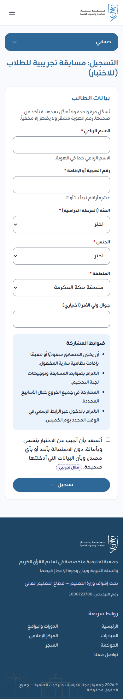
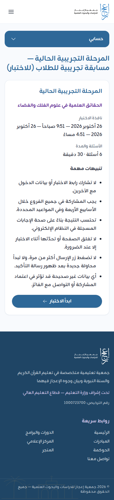
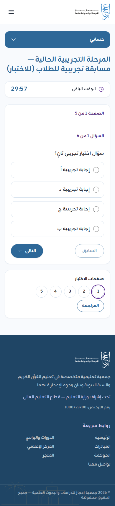
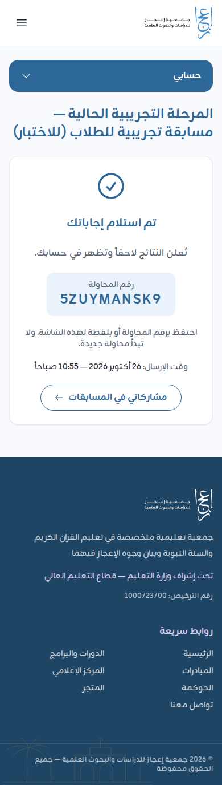
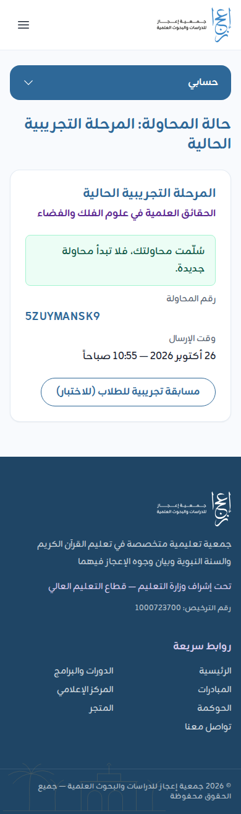

# دليل الطالب: الدخول إلى اختبار مسابقة البراهين العلمية

دليل للطالب والطالبة المشاركين في «مسابقة البراهين العلمية». مبني على «دليل الدخول إلى الاختبار» في مطوية الجمعية، ومطابق لما في الموقع. وما يختلف فيه الموقع عن المطوية مذكور في آخر الدليل.

اللقطات من نسخة محلية من البوابة بمسابقة تجريبية، فالعناوين والأسئلة فيها أمثلة.

## الفكرة باختصار

- المسابقة **أربعة فروع**، كل فرع اختبار قصير **يوم خميس**، لأربعة أسابيع متتالية:
  1. الحقائق العلمية في الأنفس.
  2. الحقائق العلمية في علوم الفلك والفضاء.
  3. الحقائق العلمية في علوم الأرض.
  4. الحقائق العلمية في علوم البحار.
- **الفئات الأربع** (تختار فئتك عند التسجيل، ويظهر لك منها ما فتحته الجمعية في هذا الموسم):
  - «المرحلة المتوسطة»: الصف الأول أو الثاني أو الثالث المتوسط.
  - «المرحلة الثانوية»: الصف الأول أو الثاني أو الثالث الثانوي.
  - «المرحلة الجامعية».
  - «المهتمون بالثقافة العلمية».
- **المشاركة في جميع الفروع شرط** لدخول الترتيب النهائي والجوائز. ويبقى لك ما شاركت فيه، وشهادة المشاركة.
- مواعيد الفروع: 【ناقص: تواريخ أيام الخميس الأربعة وساعة بداية الاختبار ونهايته، تعلنها الجمعية】

## قبل البدء

- تأكد من توفر اتصال مستقر بالإنترنت، واستخدم جهازاً مناسباً (حاسب أو جوال).
- جهّز بياناتك الأساسية كما هي في السجلات الرسمية: **اسمك الرباعي، ورقم الهوية أو الإقامة**.
- ادخل في الموعد المحدد يوم الخميس عبر **الرابط الرسمي** المنشور من جمعية إعجاز، أو **رمز الاستجابة السريعة (QR)** المعتمد. 【ناقص: الرابط الرسمي المختصر للمسابقة، يُنشر عند إطلاقها】
- يفضَّل استخدام متصفح حديث، وإغلاق التطبيقات أو الصفحات غير الضرورية.
- **تحتاج حساباً في البوابة قبل يوم الاختبار.** إن لم يكن لك حساب فأنشئه باسم مستخدم كما في [دليل المستفيد](beneficiary.md#1-إنشاء-حساب-باسم-المستخدم)، واحفظ اسم المستخدم وكلمة المرور.

## الخطوة الأولى: التسجيل في المسابقة (مرة واحدة)

1. افتح الرابط الرسمي أو امسح رمز QR. تفتح صفحة المسابقة.
2. اقرأ صفحة المسابقة: الفكرة، والضوابط، والجوائز، و«مراحل المسابقة». وفيها زر «دليل الدخول إلى الاختبار» يعرض هذه الإرشادات نفسها.
3. اضغط «سجّل في المسابقة».
   - إن لم تكن داخلاً بحسابك يظهر «سجّل الدخول للتسجيل»: اضغطه وادخل باسم المستخدم وكلمة المرور، فتعود إلى المسابقة.
   - وإن لم يكن لك حساب فاضغط «إنشاء حساب جديد».
4. املأ «بيانات الطالب» **بدقة**، فهي تُسجَّل مرة واحدة ولا تُعدَّل بعدها:
   - «الاسم الرباعي»: كما في الهوية، أربع كلمات فأكثر بالحروف.
   - «رقم الهوية أو الإقامة»: عشرة أرقام تبدأ بـ 1 أو 2. يُحفظ مشفّراً، ولا يظهر إلا مخفياً.
   - «الفئة (المرحلة الدراسية)»: المتوسطة، أو الثانوية، أو الجامعية، أو المهتمون بالثقافة العلمية. ثم «الصف» للمتوسطة والثانوية.
   - «الجنس».
   - «المنطقة».
   - «جوال ولي الأمر» (اختياري).
   - «الجهة التعليمية / المدرسة» إن ظهرت.
5. اقرأ «ضوابط المشاركة» في الصفحة، ثم ضع علامة على التعهد: «أتعهد بأن أجيب عن الاختبار بنفسي وبأمانة، دون الاستعانة بأحد أو بأي مصدر، وبأن البيانات التي أدخلتها صحيحة.».
6. اضغط «تسجيل». تظهر رسالة: «تم تسجيلك في المسابقة. ادخل الاختبار في نافذة كل مرحلة من هذه الصفحة.»، ويظهر رقمك المرجعي.

رقم الهوية الواحد لا يُسجَّل في المسابقة إلا مرة. وإن أخطأت في بياناتك فلا تسجّل مرة أخرى: أخبر رائد النشاط أو تواصل مع الجمعية لتصحيحها.

## الخطوة الثانية: الدخول إلى الاختبار (كل خميس)

1. افتح الرابط الرسمي يوم الخميس في وقت الاختبار، وادخل بحسابك.
2. في «مراحل المسابقة» يظهر لفرع اليوم زر «ادخل الاختبار». اضغطه.
   - قبل الموعد يظهر بجانب الفرع «لم تبدأ بعد». وبعد انتهاء وقت الفرع يظهر «انتهت».
3. اقرأ الصفحة الأولى بعناية: «نافذة الاختبار»، و«الأسئلة والمدة»، و«تنبيهات مهمة».
4. اضغط «ابدأ الاختبار». **يبدأ العداد الآن، ولا يتوقف إن انقطع الاتصال.**

## الخطوة الثالثة: الإجابة

1. أعلى الصفحة «الوقت الباقي». وعند بقاء خمس دقائق يظهر تنبيه.
2. اختر **إجابة واحدة** لكل سؤال.
3. انتقل بزري «التالي» و«السابق». **تُحفظ إجاباتك آلياً عند كل انتقال** بين الصفحات.
4. في «صفحات الاختبار» أسفل السؤال أرقام الصفحات: اضغط رقماً للانتقال إليه مباشرة.
5. بعض الأسئلة على نص مقروء أو مقطع: تظهر أسئلة النص مجتمعة تحته في صفحة واحدة. وللمقطع زر «شاهد المقطع».
6. ترتيب الأسئلة والخيارات يختلف من طالب لآخر، فلا تقارن بزميلك.

## الخطوة الرابعة: المراجعة والتسليم

1. بعد الإجابة عن جميع الأسئلة اضغط «المراجعة».
2. تظهر «أجبت … من …». راجع الصفحات، وارجع إلى أي صفحة لم تُجب عنها.
3. اضغط «تسليم الإجابات»، ثم أكّد. **لا يمكن تعديل الإجابات بعد التسليم.**
4. انتظر ظهور رسالة **«تم استلام إجاباتك»**.
5. احتفظ بـ**«رقم المحاولة»** الظاهر، أو بلقطة لهذه الشاشة.

- **إن انتهى الوقت قبل أن تسلّم:** تُسلَّم إجاباتك المحفوظة آلياً.
- **الدرجة لا تظهر بعد التسليم.** تُعلن النتائج لاحقاً وتظهر في حسابك في «مشاركاتي»، ومعها الشهادة عند إصدارها.

## تنبيهات مهمة

- لا تشارك رابط الاختبار أو بيانات الدخول مع الآخرين.
- يجب المشاركة في جميع الفروع خلال الأسابيع الأربعة وفي المواعيد المحددة.
- تُحتسب النتيجة بناءً على صحة الإجابات المسجلة في النظام الإلكتروني.
- لا تغلق الصفحة أو تحدّثها أثناء الاختبار إلا عند الضرورة.
- لا تضغط زر التسليم أكثر من مرة، ولا تبدأ محاولة جديدة بعد ظهور رسالة التأكيد.
- أي بيانات غير صحيحة قد تؤثر في اعتماد المشاركة أو التواصل مع الفائز.

## عند وجود مشكلة

- **إذا لم يفتح الرابط:** تحقق من الإنترنت، ثم أعد فتحه من المتصفح.
- **إذا لم تظهر الأسئلة كاملة:** جرّب متصفحاً آخر أو جهازاً مختلفاً.
- **إذا انقطع الاتصال قبل التسليم:** ادخل مرة أخرى بحسابك، وافتح صفحة المسابقة، وانظر ما يظهر بجانب فرع اليوم في «مراحل المسابقة» قبل أي شيء:
  - «أكمل الاختبار»: محاولتك جارية ولم تُسلَّم. اضغطه وتابع من حيث توقفت في **الوقت الباقي**. إجاباتك المحفوظة باقية.
  - «تم استلام إجاباتك»: سُلّمت محاولتك، فلا تبدأ محاولة جديدة. اضغطه لترى صفحة «حالة المحاولة»: سُلّمت بنفسك، أو «انتهى الوقت وسُلّمت إجاباتك المحفوظة آلياً.».
- **نسيت كلمة المرور:** استعدها من «نسيت كلمة المرور؟» إن كان في حسابك بريد أو جوال موثق. وإلا فأخبر رائد النشاط أو تواصل مع الجمعية لتعطيك كلمة مرور مؤقتة.
- **«الاختبار غير جاهز لفئتك في هذه المرحلة بعد. راجع الجمعية.»** أو **«الاختبار غير جاهز في هذه المرحلة بعد: الدرجة القصوى تختلف بين الفئات. راجع الجمعية.»:** المشكلة في إعداد الاختبار لا في جهازك. أخبر رائد النشاط فوراً.

**التواصل مع الجمعية:** البريد info@ejaz.sa، والجوال وواتساب 0550556758، أو صفحة «تواصل معنا» في الموقع. 【ناقص: هل للمسابقة رقم دعم خاص يوم الاختبار، وساعات الرد】

## ما يختلف فيه الموقع عن دليل المطوية

المطوية كُتبت قبل اكتمال المنصة، وهذا ما يجري في الموقع فعلاً:

- **الحساب أولاً:** تدخل بحسابك (اسم المستخدم وكلمة المرور)، وتسجّل في المسابقة مرة واحدة، ثم تدخل الاختبار كل خميس دون إعادة البيانات.
- **البيانات:** الجوال والبريد اختياريان في الحساب، ولا يطلبهما نموذج المسابقة. ويطلب النموذج الاسم الرباعي ورقم الهوية أو الإقامة والفئة والجنس والمنطقة.
- **الموافقة على الضوابط** تكون بالتعهد عند التسجيل.
- **زر البدء** اسمه في الموقع «ابدأ الاختبار» (في المطوية «بدء الاختبار»).
- **حفظ الإجابة آلي** عند كل انتقال، فلا زر حفظ لكل سؤال.
- **زر الإرسال** اسمه «تسليم الإجابات» بعد صفحة «المراجعة» (في المطوية «إرسال» أو «إنهاء الاختبار»).
- **«رقم المحاولة»** يظهر دائماً بعد التسليم.
- **آخر جملة** في «عند وجود مشكلة» مقطوعة في صورة المطوية. ومعناها في الموقع التحقق مما يظهر بجانب الفرع، كما في «عند وجود مشكلة» أعلاه. 【ناقص: نص الجملة كاملة من المطوية الأصلية】
