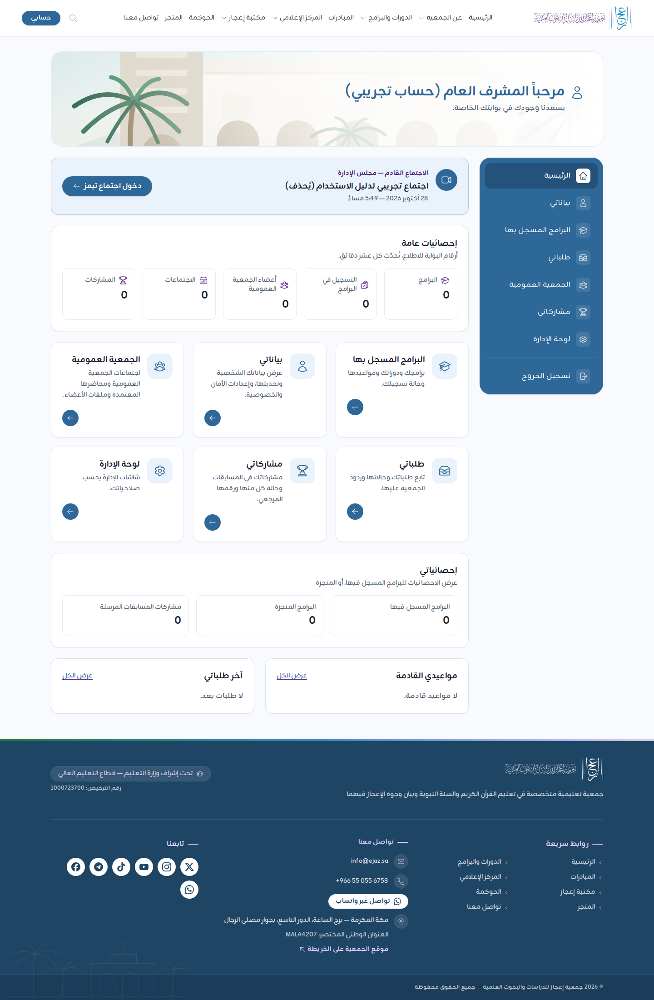
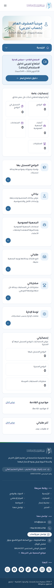
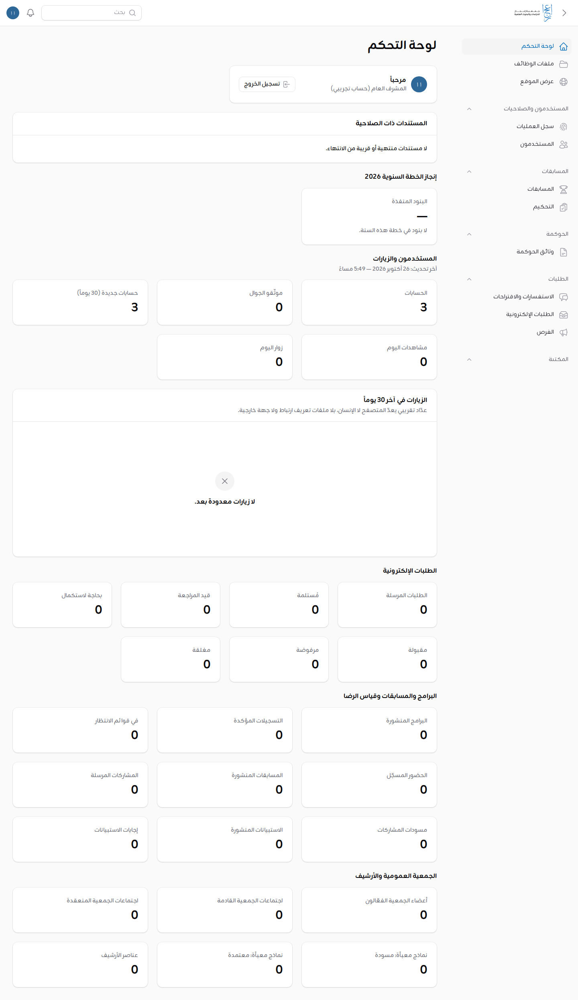
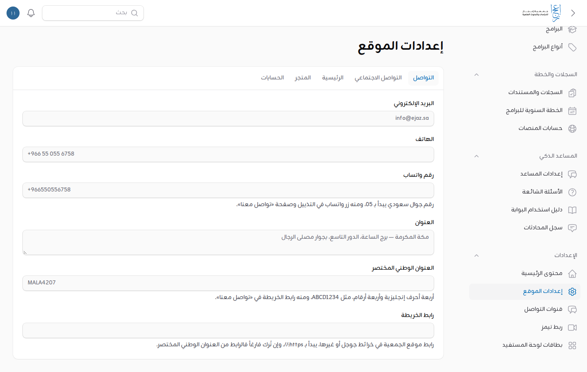

# دليل المشرف العام (اطلاع)

لمن يحمل دور «المشرف العام». الدور **اطلاع فقط**: ترى كل قائمة وسجل في البوابة ولوحة الإدارة، ولا تضيف ولا تعدّل ولا تحذف ولا تصدّر ولا تعتمد ولا تمنح أدواراً. الإضافة والتعديل للمدير التنفيذي والمسؤول التقني ([دليلهما](admin-executive-director.md)).

اللقطات في هذا الدليل من نسخة محلية من البوابة بحسابات تجريبية. والاجتماع الظاهر فيها مثال للتوضيح، والأرقام ليست أرقام الجمعية.

## 1. الدخول

1. افتح الموقع واضغط «تسجيل الدخول».
2. اكتب بريدك في «اسم المستخدم أو البريد أو الجوال»، ثم «كلمة المرور»، واضغط «تسجيل الدخول».
3. في صفحة «التحقق الثنائي» اكتب الرمز المكوّن من ستة أرقام من تطبيق المصادقة في جوالك، واضغط «تحقق».

التحقق الثنائي إلزامي لدورك. خطوات تفعيله أول مرة بالصور، وما تفعل إن ضاع الجوال، في [دليل التحقق الثنائي](two-factor.md).

بعد الدخول تفتح **لوحتك في حسابك** («حسابي» على `/account`)، لا لوحة الإدارة.

## 2. لوحتك: ما تراه وأين

من الأعلى إلى الأسفل:

1. **الاجتماع القادم:** شريط فيه «الاجتماع القادم — » واسم الجهة (الجمعية العمومية، أو مجلس الإدارة، أو لجنة)، وعنوان الاجتماع وموعده، وزر «دخول اجتماع تيمز». انظر القسم 4.
2. **«إحصائيات عامة»:** أرقام البوابة للاطلاع (القسم 3).
3. **البطاقات:** «البرامج المسجَّل فيها»، و«بياناتي»، و«الجمعية العمومية»، و«طلباتي»، و«مشاركاتي»، و«لوحة الإدارة». اضغط دائرة السهم في البطاقة لفتح قسمها.
4. **«إحصائياتي»** و**«مواعيدي القادمة»** و**«آخر طلباتي»**: تخص حسابك أنت كأي صاحب حساب.
5. **القائمة الجانبية** في اليمين بالأقسام نفسها، و«تسجيل الخروج» في أسفلها.

على الجوال تتحول القائمة الجانبية إلى زر منسدل أعلى الصفحة، والبطاقات إلى عمود واحد.

## 3. الإحصائيات

### في لوحتك

«إحصائيات عامة» خمسة أرقام: «البرامج»، و«التسجيل في البرامج»، و«أعضاء الجمعية العمومية»، و«الاجتماعات»، و«المشاركات».

- تُحسب في الخلفية وتُحدَّث كل عشر دقائق، فقد يتأخر الرقم دقائق عن الواقع.
- لا تظهر قبل أول حساب لها بعد تشغيل البوابة.

### في لوحة الإدارة

1. اضغط بطاقة «لوحة الإدارة» (أو من القائمة الجانبية).
2. في رئيسيتها: «المستندات ذات الصلاحية»، و«إنجاز الخطة السنوية»، ثم «المستخدمون والزيارات» ومجموعات الإحصائيات الأخرى، ورسم «الزيارات في آخر 30 يوماً».
3. رسم الزيارات عدّاد تقريبي يعدّ المتصفح لا الإنسان، فاقرأه اتجاهاً لا رقماً دقيقاً.

## 4. زر تيمز

1. يظهر الشريط حين يوجد اجتماع عن بعد مجدول له رابط تيمز: للجمعية العمومية، ولمجلس الإدارة، وللجان.
2. يبقى الزر من قبل الاجتماع حتى **ثلاث ساعات بعد بدئه**، ثم يختفي.
3. اضغط «دخول اجتماع تيمز» فيفتح الاجتماع في تيمز.
4. إن لم يظهر الشريط فلا اجتماع عن بعد قادم، أو أن الاجتماع حُفظ بلا رابط لأن ربط تيمز لم يُضبط بعد. 【ناقص: حساب Microsoft 365 للجمعية لتشغيل ربط تيمز الفعلي】

## 5. الاطلاع في لوحة الإدارة

- **القوائم كلها ظاهرة لك:** المستخدمون، والطلبات، والمسابقات، والبرامج، والمكتبة، والأخبار، والإعلانات، والأرشيف، والسجلات، و«سجل العمليات» وغيرها.
- **لا أزرار إضافة ولا حفظ:** لا يظهر «إضافة مستخدم» ولا «إضافة إعلان»، وصفحات الإعدادات تُفتح بحقول معطلة بلا زر «حفظ».
- **إن ضغطت إجراءً ممنوعاً** من رابط محفوظ ظهرت صفحة «لا تملك صلاحية الوصول». هذا متوقع لدورك وليس خللاً.

### أين تجد ما تحتاجه

- **من فعل ماذا ومتى:** «المستخدمون والصلاحيات» ثم «سجل العمليات».
- **الحسابات وأدوارها:** «المستخدمون والصلاحيات» ثم «المستخدمون». تصفية «طلب حذف بانتظار المعالجة» تُظهر طلبات حذف الحسابات، ومعالجتها لمديري النظام.
- **الطلبات الإلكترونية والاستفسارات:** قسم «الطلبات».
- **المسابقات ونتائجها:** قسم «المسابقات». ترى المسابقة ومراحلها، ولا تنشر ولا تسحب ولا تصدّر، ولا ترى رقم الهوية كاملاً.
- **الإعدادات التقنية:** «الإعدادات»: «إعدادات الموقع»، و«قنوات التواصل»، و«ربط تيمز»، و«محتوى الرئيسية»، كلها للاطلاع.

## 6. التنبيهات التي تصلك

تصلك التنبيهات الأمنية والتشغيلية مع مديري النظام، ومنها منح أدوار الإشراف أو سحبها من أي حساب. إن وصلك تنبيه بتغيير لم يُتفق عليه فراسل المدير التنفيذي فوراً.

## 7. إن احتجت تعديلاً

اطلبه من المدير التنفيذي أو المسؤول التقني. ولا تطلب منهما كلمة مرورهما أو رموزهما: كل عملية تُسجَّل باسم صاحب الحساب.
