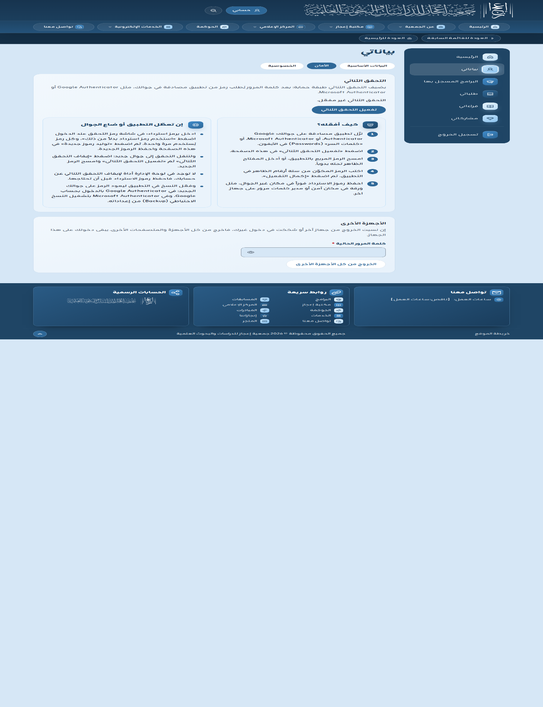
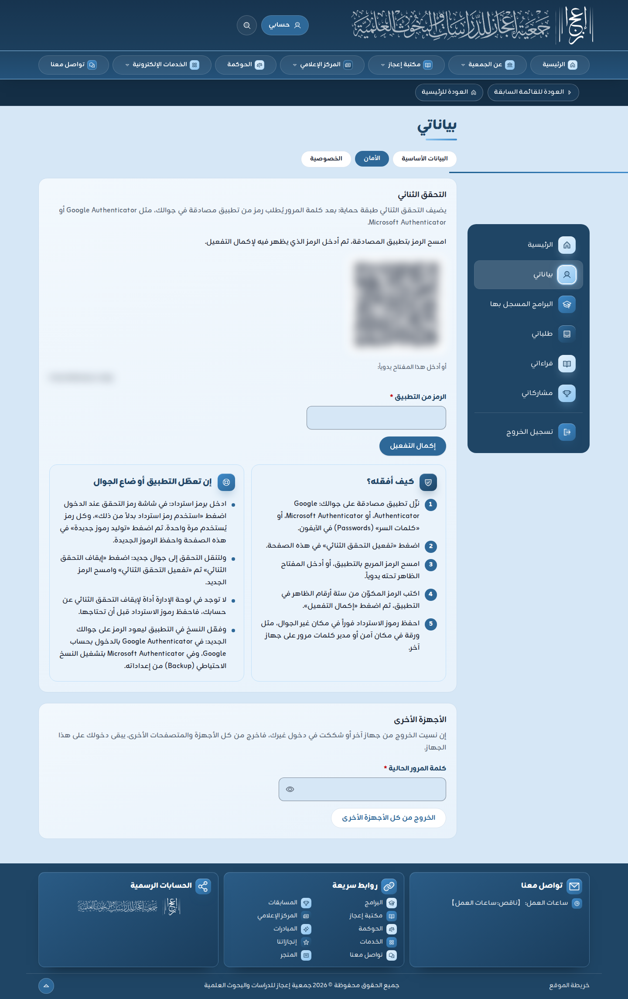
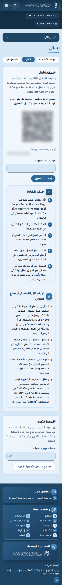
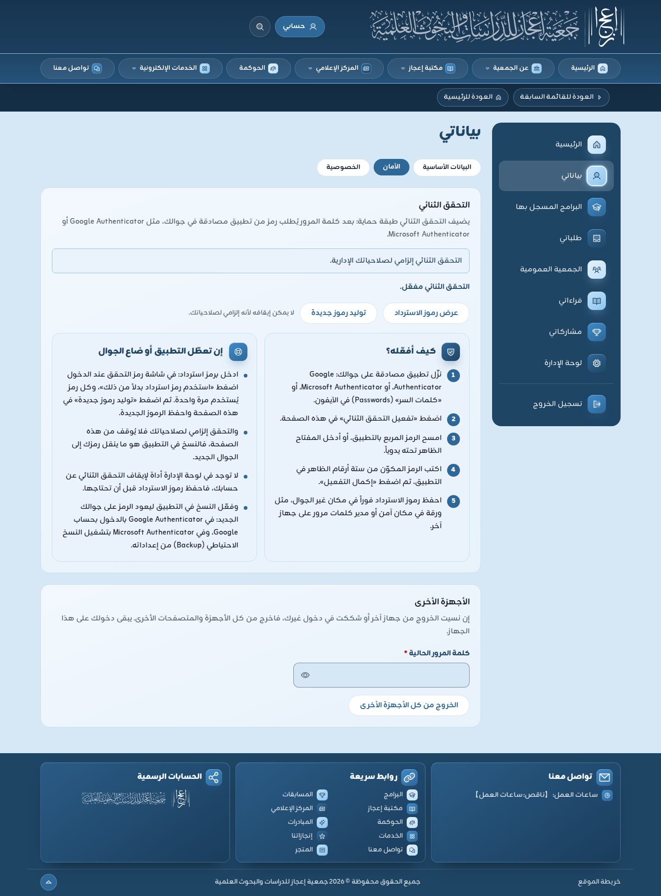

# دليل التحقق الثنائي بتطبيق المصادقة

لكل من يملك حساباً في البوابة. وهو **إلزامي** لكل دور يدخل لوحة الإدارة: لن تفتح لك اللوحة قبل تفعيله، وتنتقل إلى صفحة «الأمان» برسالة «فعّل التحقق الثنائي أولاً، فهو شرط لدخول لوحة الإدارة.». و**اختياري ومستحسن** للمستفيدين.

التحقق الثنائي طبقة حماية ثانية: بعد كلمة المرور تطلب البوابة رمزاً من ستة أرقام يظهر في تطبيق على جوالك، ويتغير كل 30 ثانية. فمن عرف كلمة مرورك لا يدخل حسابك دون جوالك.

اللقطات من نسخة محلية من البوابة بحسابات تجريبية، والرمز المربع والمفتاح فيها مضبّبان عمداً. الشرح نفسه مكتوب في صفحة «الأمان» في صندوقين: «كيف أفعّله؟» و«إن تعطّل التطبيق أو ضاع الجوال».

## 1. أين صفحة التفعيل

صفحة واحدة للمستفيد ولمديري النظام: «حسابي» ثم «بياناتي» ثم تبويب «الأمان» (الرابط `/account/security`). وتُطلب كلمة المرور قبل فتحها.

ولوحة الإدارة لا صفحة تفعيل فيها: من دخلها بدور إداري قبل التفعيل تحوّله إلى هذه الصفحة نفسها.

## 2. كيف أفعّله؟

1. نزّل تطبيق مصادقة على جوالك: Google Authenticator، أو Microsoft Authenticator، أو «كلمات السر» (Passwords) في الآيفون.
2. في صفحة «الأمان» اضغط «تفعيل التحقق الثنائي».
3. امسح الرمز المربع بالتطبيق، أو أدخل المفتاح المكتوب تحت «أو أدخل هذا المفتاح يدوياً:».
4. اكتب الرمز المكوّن من ستة أرقام الظاهر في التطبيق في خانة «الرمز من التطبيق»، ثم اضغط «إكمال التفعيل».
5. تظهر «رموز الاسترداد». احفظها فوراً في مكان غير الجوال: ورقة في مكان آمن، أو مدير كلمات مرور على جهاز آخر. كل رمز يُستخدم مرة واحدة.

وعلى الجوال تظهر الصفحة نفسها بعمود واحد:

## 3. عند كل دخول

بعد كلمة المرور تظهر صفحة «التحقق الثنائي». افتح التطبيق، واكتب الرمز الظاهر الآن، واضغط «تحقق».

تحت الخانة سطر: «الرمز يتغير كل 30 ثانية. إن لم يُقبل، فتأكد أن وقت جوالك تلقائي.». فالرمز محسوب من الوقت، وجوال وقته متأخر أو متقدم يعطي رمزاً لا تقبله البوابة. صحّح ذلك من إعدادات الجوال: التاريخ والوقت، ثم «الضبط تلقائياً».

## 4. إن تعطّل التطبيق أو ضاع الجوال

1. في صفحة «التحقق الثنائي» عند الدخول اضغط «استخدم رمز استرداد بدلاً من ذلك»، واكتب أحد رموز الاسترداد التي حفظتها.
2. بعد الدخول افتح «الأمان» واضغط «توليد رموز جديدة» واحفظها. فالقديمة لم تعد صالحة.
3. لتنقل التحقق إلى جوال جديد: اضغط «إيقاف التحقق الثنائي» ثم «تفعيل التحقق الثنائي» وامسح الرمز الجديد.
   - **لأصحاب الأدوار الإدارية:** التحقق إلزامي لدورك، فلا يظهر لك «إيقاف التحقق الثنائي». والذي ينقل رمزك إلى الجوال الجديد هو النسخ في التطبيق (البند 5).
4. **لا توجد في لوحة الإدارة أداة لإيقاف التحقق الثنائي عن حسابك**، فلا إعادة ضبط له في شاشة «المستخدمون». فاحفظ رموز الاسترداد قبل أن تحتاجها.
5. فعّل النسخ في التطبيق من اليوم، ليعود الرمز على جوالك الجديد:
   - **Google Authenticator:** ادخل فيه بحساب Google، فتُحفظ رموزك في حسابك.
   - **Microsoft Authenticator:** شغّل النسخ الاحتياطي (Backup) من إعداداته.
   - **«كلمات السر» في الآيفون:** تنتقل مع حساب Apple عند تشغيل مزامنة iCloud لكلمات السر.

## 5. أسئلة قصيرة

- **غيّرت جوالي ونقلت التطبيق بالنسخ، هل أفعل شيئاً في البوابة؟** لا. الرمز نفسه يظهر في الجوال الجديد.
- **نفدت رموز الاسترداد؟** اضغط «توليد رموز جديدة» في «الأمان» وأنت داخل حسابك.
- **فقدت الجوال ورموز الاسترداد معاً وأنا صاحب دور إداري؟** 【ناقص: إجراء استعادة الدخول لصاحب دور إداري فقد جواله ورموز الاسترداد معاً، ومن ينفّذه】 (`open-questions.md`).
